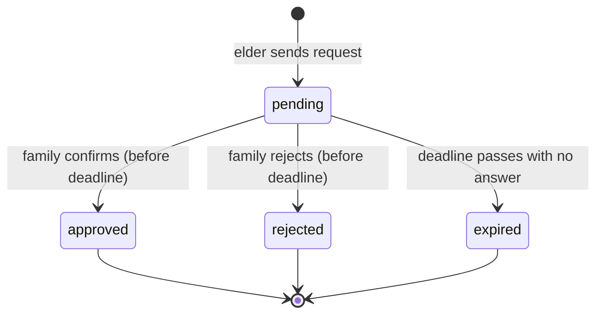
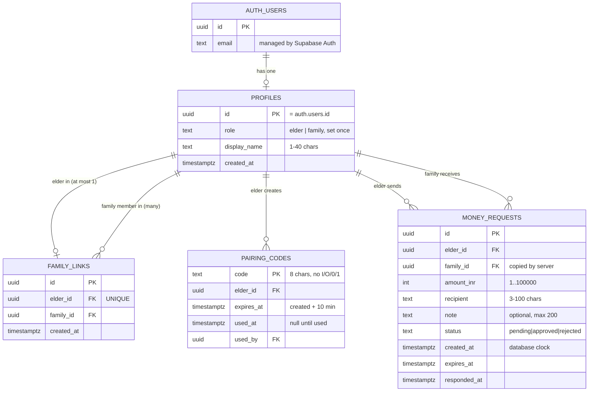
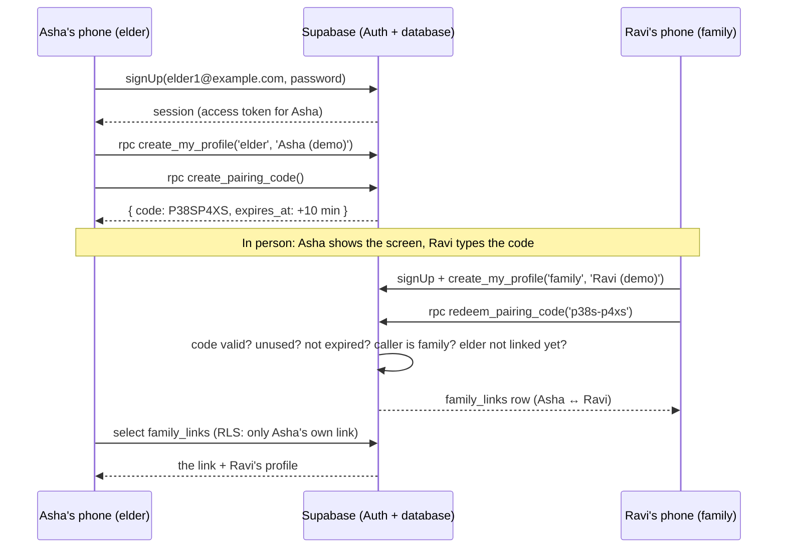

# Flod — Learning Guide

This guide grows after every phase. By the end it should let you rebuild Flod **from an empty folder without AI**. Read it in order; each section says which phase filled it in.

| # | Section | Status |
|---|---|---|
| 1 | Prerequisites and environment setup | ✅ Phase 1 |
| 2 | JavaScript and TypeScript basics used by the app | 🟡 started Phase 1 (more in 2, 5) |
| 3 | React components, props, state, events and forms | ✅ Phases 1–2 |
| 4 | Request/domain types and state transitions | ✅ Phases 1–2 (database version in Phase 3) |
| 5 | SQL schema, relations, constraints and migrations | ✅ Phase 3 |
| 6 | Authentication, roles, pairing and authorization | 🟡 concepts + database side in Phase 3; app side Phase 4 |
| 7 | Row Level Security and safe approval/rejection | 🟡 database side in Phase 3; app side Phase 6 |
| 8 | Request lifecycle and database reads/writes | ⏳ Phase 5 |
| 9 | Realtime subscriptions or polling and cleanup | ⏳ Phase 6 |
| 10 | Timeout, visual/audio warnings and failure handling | 🟡 derived expiry + visual warning in Phase 2; rest Phase 7 |
| 11 | Tests, debugging, deployment and environment variables | 🟡 tests started Phase 1; rest Phases 8–9 |
| 12 | Diagrams, glossary, common errors, exercises, rebuild checklist, judge Q&A | 🟡 glossary started; completed Phase 8 |

---

## The big picture (read first)

Flod has one job: before an elder pays an urgent request, a family member **they linked in advance** confirms the exact amount and recipient on **their own device**. Each request is in one of four states:

| State | Meaning | What the elder should do |
|---|---|---|
| `pending` | Waiting for the family member | Wait. Don't pay yet. |
| `approved` | Family member confirmed these exact details | Proceed carefully. Approval doesn't prove the recipient is safe. |
| `rejected` | Family member says they didn't ask for this | Don't pay. Call them on a known number. |
| `expired` | No answer before the deadline | **Unconfirmed** (not proven fraud). Don't pay until you reach them. |

---

## 1. Prerequisites and environment setup  *(Phase 1)*

**Install:** Node.js LTS (includes npm), Git, a code editor (VS Code). Check them:

```bash
node --version
npm --version
git --version
```

**Create the project from nothing (what Phase 1 did):**

```bash
npm create vite@latest flod -- --template react-ts
cd flod
npm install
npm install -D vitest jsdom @testing-library/react @testing-library/jest-dom
npm run dev
```

Then add the `typecheck` and `test` scripts to `package.json` (see section 11) and the `test` block in `vite.config.ts`.

**Git, first time on a computer:**

```bash
git config --global user.name "Your Name"
git config --global user.email "you@example.com"
git init
git add .
git commit -m "Initial scaffold"
```

### Concept: Node and npm
- **Node.js** runs JavaScript *outside* the browser. Our tools (Vite, TypeScript, Vitest) are JavaScript programs, so they need Node.
- **npm** is Node's package manager: it downloads libraries listed in `package.json` into `node_modules/`.
- **Analogy:** `package.json` is a shopping list, npm is the person who goes shopping, and `node_modules/` is the pantry. You never commit the pantry to Git; anyone can rebuild it from the list with `npm install`.
- `package-lock.json` records the *exact* versions bought, so every teammate gets identical packages. Commit it.

### Concept: Vite
- During development, `npm run dev` starts a local web server that serves our files and **reloads the page instantly** when you save.
- For production, `npm run build` bundles everything into a few small files in `dist/` that any static host can serve.
- **Analogy:** Vite is the kitchen. You cook (edit) in the kitchen; `build` packs the finished meal into boxes for delivery.

---

## 2. JavaScript and TypeScript basics used so far  *(Phase 1)*

| Feature | Example from our code | Meaning |
|---|---|---|
| `const` | `const now = Date.now()` | A name that won't be reassigned |
| Arrow function | `(n: number) => new Date(now + n * 60_000)` | A short way to write a function |
| Template literal | `` `status-badge status-${status}` `` | A string with a value inserted |
| Destructuring | `const { icon, label } = STATUS_LABELS[status]` | Pull named fields out of an object |
| Array `.filter` | `mockRequests.filter((r) => r.elderId === mockElder.id)` | Keep only the items that pass a test |
| Array `.map` | `requests.map((request) => <li …>)` | Turn each item into something else |
| Array `.find` | `mockRequests.find((r) => r.id === view.requestId)` | First matching item, or `undefined` |
| `??` | `familyMember?.displayName ?? 'your family member'` | Use the right side if the left is `null`/`undefined` |
| `?.` | `familyMember?.displayName` | Read a field only if the object exists |
| `import` / `export` | `export function formatInr…` / `import { formatInr } from '../lib/format'` | Share code between files |

### TypeScript types
TypeScript adds **labels describing what shape data has**. The editor and `npm run typecheck` then catch mistakes before the app runs.

```ts
// src/types/domain.ts
export type RequestStatus = 'pending' | 'approved' | 'rejected' | 'expired'

export interface MoneyRequest {
  id: string
  amountInr: number
  note: string | null   // either text or nothing
  status: RequestStatus
  // …
}
```

- A **union type** (`'a' | 'b'`) means "only one of these exact values". Writing `status: 'aproved'` (typo) is a compile error.
- An **interface** describes an object's fields.
- `string | null` means the value may be missing; TypeScript forces you to handle that case.
- **Analogy:** types are the labelled slots in a pill organiser. You can't put Tuesday's pill in the Friday slot without noticing.

**Discriminated union** (`src/types/view.ts`): every option has a `name`. After checking `view.name === 'requestDetail'`, TypeScript *knows* `view.requestId` exists.

---

## 3. React components, props, state and events  *(Phase 1; forms in Phase 2)*

### Components and JSX
A **component** is a function that returns what should appear on screen. The HTML-like syntax inside is **JSX**.

```tsx
// src/components/StatusBadge.tsx (simplified)
export function StatusBadge({ status }: StatusBadgeProps) {
  const { icon, label } = STATUS_LABELS[status]
  return (
    <span className={`status-badge status-${status}`}>
      <span aria-hidden="true">{icon}</span> {label}
    </span>
  )
}
```

JSX rules to remember:
- Use `className`, not `class`. Use `htmlFor` on labels, not `for`.
- `{ }` inserts a JavaScript value.
- A component name starts with a capital letter: `<StatusBadge />`.
- A component returns **one** parent element (or a fragment `<>…</>`).

### Props: inputs to a component
Props are arguments passed from parent to child, like function parameters.

```tsx
<RequestCard request={request} onOpen={onOpenRequest} />
```

`RequestCard` receives `request` (data) and `onOpen` (a function to call when tapped). **Data flows down through props; events flow up through callback functions.**

**Analogy:** props are an order slip handed to a cook. The cook can't change the slip; they just cook from it.

### State: memory that changes the screen
```tsx
// src/App.tsx
const [role, setRole] = useState<UserRole>('elder')
const [view, setView] = useState<View>({ name: 'elderHome' })
```

- `useState` returns the current value and a setter.
- Calling the setter (`setView(...)`) makes React **re-run the component** and update the screen.
- Never change state directly (`view.name = 'x'` won't update the screen).
- **Analogy:** state is the whiteboard in a shop. When someone rewrites it, everyone looks up and updates what they're doing.

### Events
```tsx
<button type="button" onClick={() => onSwitchRole('family')}>Family</button>
```

`onClick` receives a function that React calls when the button is pressed. In `CreateRequest.tsx`, `onSubmit` calls `event.preventDefault()` so the browser doesn't reload the page.

### Conditional rendering
```tsx
{requests.length === 0 ? <p>No requests…</p> : <ul>…</ul>}
{needsWarning && viewerRole === 'elder' && <div role="alert">…</div>}
```

### Lists and keys
```tsx
{requests.map((request) => (
  <li key={request.id}>…</li>
))}
```

`key` lets React track which item is which. Use a stable ID, not the array index.

### CSS (plain, mobile-first)
- All styles are in `src/styles/global.css`, imported once in `main.tsx`.
- **Mobile-first:** the base rules are for a ~375 px phone, and `@media (min-width: 48rem)` adds desktop tweaks.
- **Design tokens:** colours live in `:root` as variables (`--color-primary`) and are used with `var(--color-primary)`. Change once, update everywhere.
- **Accessibility built in:**
  - 18 px base text and 48 px minimum tap height;
  - a visible `:focus-visible` outline;
  - status shown with **words + symbol**, not colour alone;
  - a "Skip to main content" link.

---

## 4. Domain types  *(types in Phase 1; transitions in Phase 2)*

- `UserRole = 'elder' | 'family'`
- `RequestStatus = 'pending' | 'approved' | 'rejected' | 'expired'`
- `MoneyRequest`: one request. `amountInr` is a **whole number of rupees**, because decimals in JavaScript can round badly (`0.1 + 0.2` gives `0.30000000000000004`).
- `expired` is **calculated** from `expiresAt`, not stored (see Phase 2 below).
- `StoredStatus` = what is saved (`pending | approved | rejected`); `RequestStatus` = what is shown (adds `expired`).

---

## 11. Tests and scripts  *(started Phase 1)*

| Script | Command it runs | Why |
|---|---|---|
| `npm run dev` | `vite` | Local dev server |
| `npm run lint` | `oxlint` | Finds suspicious code (e.g. breaking React's hook rules) |
| `npm run typecheck` | `tsc -b` | Type errors across the whole project |
| `npm test` | `vitest run` | Runs all `*.test.ts(x)` files once |
| `npm run build` | `tsc -b && vite build` | Typecheck, then build `dist/` |

**How a component test works** (`src/App.test.tsx`):
```tsx
render(<App />)                                               // draw it in a fake browser (jsdom)
fireEvent.click(screen.getByRole('button', { name: 'Family' }))  // act like a user
expect(screen.getByRole('heading', { name: /requests to confirm/i })).toBeInTheDocument()  // check
```

We find elements **by role and visible text**, the way a user (or screen reader) would. If a test can't find a button by its name, a blind user probably can't either.

---

## Phase 1 file-by-file

| File | What it does / why it exists | Inputs → outputs | Common mistakes | Practice task |
|---|---|---|---|---|
| `package.json` | Project name, scripts, dependency list | — | Editing `node_modules` by hand; forgetting to commit `package-lock.json` | Add a script `"hello": "echo hi"` and run `npm run hello` |
| `vite.config.ts` | Vite plugins + Vitest settings (jsdom, setup file) | — | Forgetting `environment: 'jsdom'` → "document is not defined" in tests | Find where the setup file path is set |
| `tsconfig*.json` | TypeScript settings: `app` for `src/`, `node` for config files | — | Turning off `strict` checks to "fix" errors | Find which file includes the `src` folder |
| `.oxlintrc.json` | Lint rules (React hooks, TypeScript) | — | Ignoring warnings | Read the two React rules and explain them |
| `index.html` | The single HTML page; `<div id="root">` is where React draws | — | Removing the `root` div | Change the `<title>` and watch the tab update |
| `src/main.tsx` | Starts React: finds `#root`, renders `<App />`, imports CSS | — | Importing CSS twice | Explain what `StrictMode` is for (look it up) |
| `src/App.tsx` | Holds `role` + `view` state, chooses the page, filters mock data | state → which page shows | Calling `setView` directly instead of `goTo` (skips scroll-to-top) | Make the app start on the Safety page |
| `src/types/domain.ts` | Shared data shapes | — | Using `number` for status instead of a union | Add `'cancelled'` to `RequestStatus` and follow the type errors (then undo) |
| `src/types/view.ts` | Which screens exist | — | Adding a screen here but not in `App.tsx`'s `switch` | — |
| `src/mock/mockData.ts` | Synthetic profiles + 4 requests (one per status) | — | Using real names/UPI IDs | Add a 5th pending request |
| `src/lib/format.ts` | `formatInr`, `formatDateTime` using `Intl` | number/ISO string → readable text | Hand-writing commas (Indian grouping is 1,00,000) | Add `formatShortDate` |
| `src/components/Layout.tsx` | Header, demo banner, demo role switch, nav, `<main>` | role, current view, callbacks, children | Using `<div onClick>` instead of `<button>` (keyboard users can't press it) | Add a footer line |
| `src/components/StatusBadge.tsx` | Status as text + symbol | `status` → badge | Showing colour only | Change an icon |
| `src/components/RequestCard.tsx` | Tappable summary of one request | `request`, `onOpen` | Putting `<div>` inside `<button>` (invalid HTML; we use `<span>`) | Show the note on the card |
| `src/pages/ElderHome.tsx` | Greeting, main action, elder's requests | elder, family, requests, callbacks | Forgetting the empty state | — |
| `src/pages/CreateRequest.tsx` | Page around the form (Phase 2: the form itself moved to `RequestForm`) | family, `onSubmit`, `onCancel` | Inputs without `<label htmlFor>` | — |
| `src/pages/FamilyInbox.tsx` | Requests assigned to the family member | family, requests, `onOpenRequest` | — | — |
| `src/pages/RequestDetail.tsx` | Full details + warning for rejected/expired (elder view) | request, people, viewer role | Wording that claims "scam" or "safe" | — |
| `src/pages/AboutSafety.tsx` | What answers mean, what Flod does NOT do | — | Overclaiming | — |
| `src/styles/global.css` | All styling, mobile-first | — | Fixed pixel widths that overflow phones | — |
| `src/test/setup.ts` | Test helpers: jest-dom matchers, cleanup, `scrollTo` stub | — | — | — |
| `*.test.ts(x)` | Automated checks | — | Testing CSS class names instead of what the user sees | — |
| `.gitignore` | Keeps `node_modules`, `dist`, `.env*` out of Git | — | Committing `.env.local` | — |
| `.env.example` | Placeholder names for Phase 4 settings | — | Putting real keys here | — |

---

## How to add a small component without AI (recipe)

1. **Decide the props.** What does it need from its parent? Write them as an interface.
2. **Create the file** `src/components/MyThing.tsx`:
   ```tsx
   interface MyThingProps {
     text: string
   }

   export function MyThing({ text }: MyThingProps) {
     return <p className="my-thing">{text}</p>
   }
   ```
3. **Use it** in a page: `import { MyThing } from '../components/MyThing'`, then `<MyThing text="Hello" />`.
4. **Style it** in `global.css` with `.my-thing { … }`.
5. **Check:** `npm run typecheck` (did you pass the right props?), `npm run lint`, then look in the browser.
6. **Test it** (optional): copy `StatusBadge.test.tsx`, render your component, and `expect` the text.

---

## Phase 1 exercises (do these without AI)

1. **Footer.** Create `src/components/Footer.tsx` that shows "Flod prototype · synthetic data". Render it at the bottom of `Layout`, style it with small muted text, and make sure `npm run lint`, `npm run typecheck` and `npm test` still pass.
2. **New mock request.** Add a fifth mock request for ₹999 with status `pending`. Where does it appear, and why does it appear in *both* the elder and family lists?
3. **Break it on purpose.** In `RequestCard.tsx`, change `request.amountInr` to `request.amount`. Run `npm run typecheck`. Read the error and explain it in your own words, then undo the change.
4. **Test it.** Write a test that switches to Family, opens the ₹25,000 request, and checks that a "Confirm request" button appears. (Updated after Phase 2 added the buttons.)

*(Answers aren't included. Try first, then ask a teammate or your reviewer.)*

## Phase 1 self-test

1. What does `npm install` read, and where does it put things?
2. What is the difference between a prop and state?
3. Why does `RequestCard` receive an `onOpen` function instead of changing the view itself?
4. Why is `amountInr` a whole number?
5. What does `key={request.id}` do?
6. Why are statuses shown with words and symbols, not just colours?
7. What file decides which page is visible?
8. Why does `.env.example` exist if `.env` files are ignored by Git?

---

---

# Phase 2 — The request lifecycle with local mock data

## Request states and transitions (section 4, continued)



Rules (in `src/mock/mockStore.ts`, later in the database):
- A request **always starts** as `pending`. The elder can't choose its status.
- Only the **linked family member** may answer, and only **once**, and only **before the deadline**.
- Answers are final: nothing moves back to `pending`.
- `expired` is **derived**, never saved. The saved status stays `pending`, and `getEffectiveStatus()` says "expired" once `now >= expiresAt`. A derived value can't go out of date: no timer has to remember to flip it.

**Analogy:** a milk carton doesn't change its label at midnight. You compare the printed date with today's date when you look at it. `expiresAt` is the printed date; `getEffectiveStatus` does the comparing.

## New React concepts (section 3, continued)

### Controlled inputs
In a **controlled** input, React state is the single source of truth. The input only shows what state says, and every keystroke updates state.

```tsx
// src/components/RequestForm.tsx
const [values, setValues] = useState<RequestFormValues>({ amount: '', recipient: '', note: '' })

<input
  id="amount"
  value={values.amount}                                           // state → screen
  onChange={(event) => updateField('amount', event.target.value)} // screen → state
/>
```

**Analogy:** a scoreboard operator. The board (input) shows only what the operator (state) writes. If you forget `onChange`, the input is "frozen", because typing never reaches the operator.

### Events
- `onChange` fires on every keystroke and gives you `event.target.value` (always a **string**, even in a number field).
- `onSubmit` on the `<form>` fires on button click **or** Enter. Call `event.preventDefault()` or the browser reloads the page and your state is lost.
- `onClick` on buttons. Always use `<button type="button">` unless it should submit a form.

### Form validation
`validateRequestForm(values)` in `src/lib/validation.ts` is a **pure function**: text in, verdict out. It touches no React and no screen, so it's easy to test.

```ts
validateRequestForm({ amount: '25,000', recipient: 'shop@demo-upi', note: '' })
// → { ok: true, data: { amountInr: 25000, recipient: 'shop@demo-upi', note: null } }

validateRequestForm({ amount: '-50', recipient: '', note: '' })
// → { ok: false, errors: { amount: 'Use whole rupees…', recipient: 'Enter who you are…' } }
```

- It returns a **result object** (`ok: true` with clean data, or `ok: false` with messages) instead of throwing errors. TypeScript then forces callers to handle both cases.
- **Browser validation is for kindness, not security.** Anyone can skip it (for example with the browser's dev tools). Phase 3 repeats these limits in the database, where they can't be skipped.
- Accessibility: errors are text (never only a red border); `aria-invalid` and `aria-describedby` connect each error to its input; focus jumps to the first problem.

### State updates must create new values (immutability)
React only notices a change when you give it a **new** object or array.

```ts
// ✅ new object: copy the old fields, overwrite one
setValues((previous) => ({ ...previous, [field]: value }))

// ✅ new array with one item replaced
requests.map((r) => (r.id === requestId ? updated : r))

// ❌ mutating: same array object, so React may not re-render
requests[0].status = 'approved'
```

`setValues((previous) => …)` is the **functional update** form. It always uses the latest state, which is safer when an update depends on the previous value.

### Lifting state up
The elder screen and the family screen must see the **same** list. So the list lives in their common parent, `App.tsx`, and goes down to each page as a prop:

```
App  ── requests (state) ──┬──> ElderHome / RequestDetail (elder view)
                           └──> FamilyInbox / RequestDetail (family view)
        ▲
        └── handleCreate / handleRespond (callbacks): the only places that change it
```

### Conditional rendering, three ways
```tsx
{errors.amount && <p className="field-error">{errors.amount}</p>}       // && : show or nothing
{waiting.length === 0 ? <p>Nothing is waiting…</p> : <ul>…</ul>}        // ? : : one or the other
switch (status) { case 'pending': return …; case 'approved': return … } // many options (StatusBanner)
```

Using `switch` on a union type has a bonus: if someone adds a fifth status, TypeScript complains about every `switch` that forgot it.

### Effects and cleanup (preview of Phases 6–7)
`useNow()` (in `src/hooks/useNow.ts`) starts a 1-second timer with `useEffect` and **returns a cleanup function** that stops it:

```ts
useEffect(() => {
  const timerId = setInterval(() => setNow(Date.now()), 1000)
  return () => clearInterval(timerId) // runs when the component disappears
}, [])
```

Forgetting the cleanup leaves timers running forever. That's a classic bug, and it matters again for Realtime subscriptions in Phase 6.

## Why local state can't synchronise two devices

React state lives **in the memory of one browser tab**. Your phone and your relative's phone each run their own copy of the app with their own memory. When Asha's phone runs `setRequests(...)`, nothing travels over the internet; Ravi's phone has no idea it happened. Even two tabs on the same laptop don't share state, and reloading wipes it.

**Analogy:** two people each writing on their own notepad. To share, you need a **shared noticeboard** that both can read and write: a database on a server. That's Supabase, from Phase 3. Then live updates (Phase 6) are like the noticeboard ringing a bell when something changes.

That's why the header says "kept only in this browser tab", and why the demo uses the Elder/Family switch in one tab.

## Data-flow walkthrough: one request, start to finish

1. **Elder types.** Each keystroke runs `updateField` and `setValues`, then React re-renders the form. Values are strings: `amount = "2500"`.
2. **Elder taps "Send to family to confirm".**
   - The `<form onSubmit>` runs `handleSubmit`, which calls `preventDefault()`.
   - `validateRequestForm(values)` returns `{ ok: true, data: { amountInr: 2500, … } }`.
   - `onSubmit(data)` passes it up to the `CreateRequest` page, then up to `App.handleCreate`.
3. **`App.handleCreate`** calls `createRequest(requests, input, link, Date.now())`.
   - That returns a **new** array with a `pending` request whose `expiresAt` is now + 60 s.
   - `setRequests(newArray)` saves it, and `openRequest(created.id)` shows its detail page.
4. **Re-render.** `RequestDetail` calls `getEffectiveStatus(request, nowMs)`, which returns `pending`, so `StatusBanner` shows "Waiting for Ravi… Do not pay yet."
5. **Switch to Family.**
   - `role` becomes `family`, and the same request stays open.
   - `RequestDetail` now shows `FamilyResponse` with Confirm and Reject buttons, because the status is `pending`.
6. **Ravi taps "Reject request".**
   - `answer('rejected')` calls `onRespond`, which reaches `App.handleRespond`, which calls `respondToRequest(...)`.
   - The checks pass (it exists, it's Ravi's, it's pending, it isn't expired), so it returns a new array with `status: 'rejected'` and `respondedAt` set.
   - `setRequests(...)` saves it, the buttons disappear, and the outcome message appears.
7. **Switch to Elder.** The status is `rejected`, so `StatusBanner` renders `WarningPanel` with the "Pause…" warning (`role="alert"`).
8. **Alternative: nobody answers.** Every second `useNow` ticks and the app re-renders. Once `nowMs >= expiresAt`, the status becomes `expired`, and the elder sees the warning saying no reply is not proof of a scam.

## Phase 2 file-by-file

| File | What / why | Inputs → outputs | Important parts | Common mistakes | Practice task |
|---|---|---|---|---|---|
| `src/config.ts` | One place for the demo timeout | — | `REQUEST_TIMEOUT_SECONDS` | Hard-coding `60` in several files | Change it to 20 and watch a request expire |
| `src/lib/validation.ts` | Turns raw form text into clean data or friendly errors | `RequestFormValues` → `ValidationResult` | regex `/^\d+$/`, limit constants | `Number('')` gives `0`; `parseInt('12abc')` gives `12` | Reject recipients containing spaces |
| `src/lib/requestStatus.ts` | Works out the status to show | request + now → `RequestStatus` | `getEffectiveStatus`, `canBeAnswered` | Saving "expired" in state and forgetting to update it | Add `secondsLeft(request, now)` |
| `src/mock/mockStore.ts` | Local stand-in for database rules | list + action → new list or error | `createRequest`, `respondToRequest` | Mutating the old array; forgetting the "already answered" check | Write `cancelRequest` (exercise 1) |
| `src/hooks/useNow.ts` | A clock that re-renders every second | interval → current ms | `useEffect` + cleanup | No `clearInterval` | Make it tick every 5 s and observe |
| `src/components/RequestForm.tsx` | Controlled form, shows errors | callbacks → `NewRequestInput` | `updateField`, `handleSubmit` | Missing `preventDefault`; `value` without `onChange` | Add a character counter for the recipient |
| `src/components/StatusBanner.tsx` | Elder's message for each status | status, name → banner | `switch` on status | Saying "safe" or "scam" | Change the pending wording |
| `src/components/WarningPanel.tsx` | The big "Pause." warning | reason, name → alert | `role="alert"`, one-paragraph sentence | Relying on colour or sound only | — |
| `src/components/FamilyResponse.tsx` | Confirm/Reject, error, outcome | status, callback → buttons/message | local `error` state | Showing buttons for non-pending requests | — |
| `src/App.tsx` | Owns the shared `requests` state | — | `handleCreate`, `handleRespond`, `switchRole` | Changing `requests` anywhere else | — |
| `*.test.ts(x)` | Prove validation, transitions, wording and the full flow | — | fake timers in `App.test.tsx` | Testing implementation details instead of behaviour | Add a test for a 201-character note |

## Phase 2 exercises (no AI; answers aren't included)

1. **Add a "Cancel request" action (mock data only).** The elder should be able to cancel their own request while it's still pending.
   - Add a status for it (think about `StoredStatus`, `RequestStatus`, `StatusBadge` labels, and every `switch` TypeScript then complains about).
   - Write `cancelRequest(requests, requestId, elderId, nowMs)` in `mockStore.ts` with the same style of checks as `respondToRequest`. Who may cancel? What if it's already answered or expired?
   - Add a "Cancel this request" button for the elder, shown only while pending, and the message the family member sees afterwards.
   - Write at least two tests: cancelling works; cancelling an approved request is refused.
2. **Trace by hand.** On paper, follow what happens when Ravi taps **Confirm** and then the request is somehow answered again. Which line in `respondToRequest` stops the second answer from changing anything?
3. **Validation edge cases.** Predict the result of `validateRequestForm` for amounts `"007"`, `"1,00,000"`, `" 5 "` and `"१०००"` (Devanagari digits). Then write tests to check your predictions.
4. **Two tabs.** Open the app in two tabs. Create a request in one. Explain in two sentences why the other tab doesn't show it.

## Phase 2 self-test

1. What makes an input "controlled"?
2. Why does `handleSubmit` call `event.preventDefault()`?
3. Why is `expired` calculated instead of saved?
4. Why must `respondToRequest` return a **new** array?
5. Where does the `requests` state live, and why there?
6. What would happen if `useNow` didn't return a cleanup function?
7. Why isn't browser-side validation enough for security?
8. What exactly does "Confirmed by family" promise, and what does it **not** promise?


---

---

# Phase 3 — The database: schema, Row Level Security and safe functions

The app doesn't use the database yet (that's Phases 4–6). This phase builds and checks the foundation.

## 5. SQL schema, relations, constraints and migrations

### Tables, rows, columns
A **table** is like a spreadsheet tab with strict rules. Each **column** has a name and a type; each **row** is one record.

`money_requests` (one row = one request):

| id | elder_id | family_id | amount_inr | recipient | status | created_at | expires_at | responded_at |
|---|---|---|---|---|---|---|---|---|
| 7c1e… | a1… | b2… | 2500 | test.shop@demo-upi | pending | 10:00:00 | 10:01:00 | *null* |

Compare it with the TypeScript `MoneyRequest` in `src/types/domain.ts`. It's the same shape, with `snake_case` names instead of `camelCase`. Phase 5 converts between them.

### Our schema



### Keys
- **Primary key (PK):** the column that uniquely identifies a row, like a roll number. `money_requests.id` is a random UUID made by the database (`default gen_random_uuid()`).
- **Foreign key (FK):** a column that must match a row in another table. `money_requests.elder_id references profiles(id)` means you can't create a request for an elder who doesn't exist.
- **`on delete cascade`:** if the parent row is deleted, delete the children too. Deleting a user removes their profile, links, codes and requests, so nothing is left orphaned.

**Analogy:** the PK is a student's roll number. An FK is "roll number written on an exam paper"; the school checks that the student really exists.

### Constraints: rules the database enforces, whoever is asking
| Constraint | Where | What it stops |
|---|---|---|
| `not null` | most columns | Missing data |
| `check (amount_inr between 1 and 100000)` | money_requests | Zero, negative or huge amounts, even if someone skips the form |
| `check (status in ('pending','approved','rejected'))` | money_requests | Made-up statuses |
| `check ((status = 'pending') = (responded_at is null))` | money_requests | "Approved" with no answer time, or "pending" with one |
| `unique (elder_id)` | family_links | A second trusted relative for the same elder |
| `check (elder_id <> family_id)` | links, requests | Linking to yourself |
| `check (code ~ '^[A-HJ-NP-Z2-9]{8}$')` | pairing_codes | Badly formed codes |

These repeat `src/lib/validation.ts` on purpose. **Browser checks are for kindness; database checks are for safety.**

### Migrations
A **migration** is a numbered SQL file that changes the database's structure. You run them in order (`0001` → `0002` → `0003`), and they live in Git like any other code, so every teammate (and the judges) can rebuild the same database and review every change.
- Ours are **re-runnable**: `create table if not exists`, `drop policy if exists` then `create policy`, `create or replace function`. Running a file twice is harmless.
- **Rule:** once a migration has been applied to a shared database, don't edit it. Add `0004_…` instead (Phase 6 will add `0004_realtime.sql`).

## 6–7. Authentication vs authorization, and Row Level Security

- **Authentication** answers "who are you?". Supabase Auth checks the email and password and gives the browser a signed **token** containing the user's id. In SQL, `auth.uid()` reads that id.
- **Authorization** answers "what may you do?". That's our job: RLS policies and the checks inside the functions.
- **Analogy:** authentication is the ID check at the building entrance. Authorization is which rooms your key card opens.

### Two locks on every table
1. **Grants** (table-level): `revoke all … from anon, authenticated` then `grant select … to authenticated`. Logged-out visitors can't touch the tables at all; signed-in users can only *read*.
2. **RLS policies** (row-level): *which* rows they can read. With RLS enabled and no matching policy, you see **zero rows**, so the default is "deny".

### Our five policies, translated into plain English
| Policy | SQL condition | Plain English |
|---|---|---|
| profiles: read own | `id = auth.uid()` | You can see your own profile. |
| profiles: read linked person | exists a `family_links` row joining you and them | You can see the name of the one person you're linked with, and no one else. |
| family_links: read if member | `elder_id = auth.uid() or family_id = auth.uid()` | You can see a link only if you're one of its two people. |
| pairing_codes: read own | `elder_id = auth.uid()` | Only the elder who created a code can see it. |
| money_requests: read if elder or assigned family | `elder_id = auth.uid() or family_id = auth.uid()` | A request is visible to its elder and its assigned family member, nobody else. |

`(select auth.uid())` is written with `select` so Postgres works out the user id once per query instead of once per row (faster, same result).

### Why writes go through functions, not UPDATE policies
If we gave family members an UPDATE policy "you can update requests sent to you", they could change **any column** of those rows: the amount, the recipient, or the status back to `pending`. RLS decides *which rows*, not *which columns or values*. So instead:

- There are **no** INSERT, UPDATE or DELETE rights for users at all.
- Five small functions each do **one** job and check everything themselves.
- They are `security definer`: they run with the table owner's rights, like a bank teller who can open the vault but follows strict rules for each customer.
- `set search_path = ''` and fully qualified names (`public.money_requests`) stop anyone tricking the function into using a look-alike table.
- EXECUTE is granted to `authenticated` only; logged-out visitors can't call them.

### The approve/reject function, line by line
```sql
update public.money_requests
set status = p_decision, responded_at = now()   -- only these two columns can change
where id = p_request_id
  and family_id = v_uid          -- only the assigned family member (not the elder, not a stranger)
  and status = 'pending'         -- only once; can never go back to pending
  and expires_at > now()         -- not after the deadline (database clock, not the phone's)
returning * into v_row;
```

If two answers arrive at the same moment, Postgres locks the row. The second `UPDATE` waits, then re-checks `status = 'pending'`, finds it false, and changes nothing. If no row matched, the function explains why, but says "Request not found" to strangers so it doesn't reveal that the request exists.

## Example queries

Run these in the Supabase SQL Editor. As the owner you see everything, because RLS doesn't apply to the table owner.

```sql
-- All requests, newest first, with names
select r.amount_inr, r.recipient, r.status, e.display_name as elder, f.display_name as family
from public.money_requests r
join public.profiles e on e.id = r.elder_id
join public.profiles f on f.id = r.family_id
order by r.created_at desc;

-- Which requests are effectively "expired" right now?
select id, amount_inr from public.money_requests
where status = 'pending' and expires_at <= now();

-- Pretend to be a signed-in user (this is how rls_checks.sql works). Inside a transaction:
begin;
select set_config('role', 'authenticated', true);
select set_config('request.jwt.claims', '{"sub":"<a user id>","role":"authenticated"}', true);
select count(*) from public.money_requests;   -- now filtered by RLS
rollback;
```

How the app will call the functions later (Phase 4–6 preview; not in the code yet):
```ts
await supabase.rpc('create_money_request', {
  p_amount_inr: 2500,
  p_recipient: 'shop@demo-upi',
  p_note: null,
  p_timeout_seconds: 60,
})
await supabase.rpc('respond_to_request', { p_request_id: id, p_decision: 'approved' })
```

## How the security was tested
`supabase/checks/rls_checks.sql` creates four throwaway users (Elder A, Family B linked to A, Stranger C, Elder D). It plays each one and tries 36 allowed or forbidden actions. Each result is recorded as PASS or FAIL.

To check that the checks themselves work, we ran them against a **deliberately broken** copy (RLS turned off, UPDATE allowed). They correctly reported FAIL. A test that never fails proves nothing.

Honesty note: so far this ran on PGlite (real PostgreSQL in WebAssembly) with a stand-in for Supabase's auth pieces, **not** on a real Supabase project. Running it on yours is README step 4.

## Phase 3 file-by-file

| File | What / why | Important parts | Common mistakes | Practice task |
|---|---|---|---|---|
| `0001_tables.sql` | Structure + rules for data | FKs with `on delete cascade`, `check` constraints, indexes | Forgetting `not null`; using `float` for money | Add a `check` that `recipient` has no leading/trailing spaces |
| `0002_rls.sql` | Who can read which rows | `enable row level security`, `revoke`/`grant`, 5 policies | Enabling RLS but leaving broad grants; adding an UPDATE policy "to make it work" | Write the policy for "elders can read their own pairing codes" from memory |
| `0003_functions.sql` | The only write paths | `auth.uid()` checks, conditional `UPDATE`, `security definer`, `search_path = ''`, grants | Forgetting to revoke EXECUTE from `anon`; trusting a user id passed as a parameter | Explain why `create_money_request` has no `p_family_id` parameter |
| `rls_checks.sql` | Proves the rules | `act_as()`, `begin … exception … end` blocks | Only testing the "happy path" | Add a check: stranger C cannot redeem elder D's fresh code after it's used |

## Phase 3 exercises (no AI; answers aren't included)

1. **Policies in plain English.** Cover the table above. For each of the five policies in `0002_rls.sql`, write one plain-English sentence about who can see what. Then check yourself against the table.
2. **Predict, then check.** For each scenario, say "rows visible", "error" or "allowed", and which line of SQL decides it:
   - Stranger C runs `select * from money_requests`.
   - Family B runs `update money_requests set amount_inr = 1`.
   - Elder A calls `respond_to_request(<A's own request>, 'approved')`.
   - Family B calls `respond_to_request` 2 minutes after the deadline.
   - A logged-out visitor calls `create_pairing_code()`.
3. **Break it on purpose (local or a throwaway project only).** Comment out the `and status = 'pending'` line in `respond_to_request`, re-run `0003`, then run `rls_checks.sql`. Which check fails, and why? Restore the line afterwards.
4. **Design question.** Write half a page: what would go wrong if `money_requests` had the policy `for update using (family_id = auth.uid())` instead of our function? Give two concrete attacks.

## Phase 3 self-test
1. What's the difference between a primary key and a foreign key? Give one example of each from our schema.
2. Why is `amount_inr` an `integer` with a `check`, and why repeat the browser's validation here?
3. Authentication vs authorization: which one does `auth.uid()` give you, and which one do policies provide?
4. With RLS enabled and no policies, what does a signed-in user see?
5. Why do users have SELECT but no INSERT, UPDATE or DELETE?
6. What does `security definer` mean, and what two precautions do we take because of it?
7. How does `respond_to_request` stop a duplicate answer, even if two arrive at the same instant?
8. Why does the server, not the browser, choose `family_id` and `expires_at`?


---

# Phase 4 — Authentication and trusted-family pairing

What changed: the app now has **real accounts** (Supabase Auth), a **role chosen once**, and **pairing with a one-time code**. Money requests are still the local mock store from Phase 2; Phase 5 moves them into the database.

## 6. Authentication, roles, pairing and authorization (section 6, continued)

### Sessions and tokens
When you sign in, Supabase checks your email and password and gives the browser a **session**: an **access token** (a signed note saying "this is user `5b1e…`", valid for about an hour) plus a **refresh token** used to get a new access token before the old one runs out. `supabase-js` saves the session in the browser's `localStorage`, attaches the access token to every request, and refreshes it for you. That's why a reload keeps you signed in.

*Analogy:* a festival wristband. The ticket desk (Auth) checks your ticket once and gives you a wristband (access token). Every stall (database) looks at the wristband instead of asking for your ticket again. The wristband expires, so you swap it for a fresh one (refresh token) without queueing again.

### User id, profile and role
- The **user id** comes from Supabase Auth (`auth.users`). The browser never chooses it; the database reads it from the token with `auth.uid()`.
- The **profile** (`public.profiles`) adds what *our* app needs: role and display name.
- The **role is stored in the database and set once** by `create_my_profile`. There is no update function, so it can never change. A role kept only in React state could be edited by anyone with the browser's developer tools.

### Why "pick your trusted family member from a list" is insecure
If the browser sent "link me with user X", anyone could link themselves to any elder and approve that elder's requests. Instead:
1. The elder's phone asks the **database** for a random code (`create_pairing_code`).
2. The family member types it **while they're together in person**.
3. The **database** checks that the code exists, hasn't been used and hasn't expired, then creates the link in one transaction (`redeem_pairing_code`).

The browser only ever sends a code. It never sends user ids.

### Single-use, short-lived codes
- **Short-lived (10 minutes):** a code photographed or overheard is soon useless.
- **Single-use:** `used_at` is set when redeemed; a second attempt gets "already been used".
- **One family member per elder:** `family_links.elder_id` is `unique`.
- **Random from 32 characters, 8 long:** about 10¹² possibilities, generated with a cryptographic random generator.
- **The in-person rule is the real defence.** A scammer on the phone may ask the elder to read out the code. The screen warns against exactly that.

### Sequence diagram: linking Asha and Ravi


## New React and TypeScript concepts (Phase 4)

### Context: sharing "who is signed in" without passing props everywhere
`AuthProvider` loads the session, profile and link once and puts them in a **context**. Any component below it calls `useAuth()` to read them.
```tsx
const AuthContext = createContext<AuthValue>({ status: 'loading' })
export function useAuth() { return useContext(AuthContext) }
// main.tsx
<AuthProvider><App /></AuthProvider>
```
*Analogy:* a notice board in the hallway. Instead of handing a note to every room, you pin it up once and every room can read it.

### A discriminated union for "where is this person?"
```ts
type AuthValue =
  | { status: 'loading' }
  | { status: 'signedOut' }
  | { status: 'error'; message: string; retry: () => void; signOut: () => void }
  | { status: 'signedIn'; user: User; profile: Profile | null; link: MyLink | null; refresh: () => void; signOut: () => void }
```
After `if (auth.status === 'signedOut') return …`, TypeScript **narrows** `auth`, so later lines can safely use `auth.profile`. Forgetting a case becomes a type error instead of a crash.

### The gate: early returns in order
`App.tsx` asks the same questions for every person: loading? signed out? error? no profile? no link? Each "no" returns a different screen; only a person who passes every check reaches `SignedInApp`.

### Subscriptions and cleanup (again)
`supabase.auth.onAuthStateChange(...)` keeps calling us on sign-in, sign-out and token refresh. The effect returns `() => data.subscription.unsubscribe()` so the listener is removed when the component goes away. This is the same idea as `clearInterval` in `useNow`.

### Async event handlers: busy, try, catch, finally
```tsx
setBusy(true)
try {
  await redeemPairingCode(code)
  onLinked()
} catch (error) {
  setErrorMessage(error instanceof Error ? error.message : 'Could not link. Please try again.')
} finally {
  setBusy(false) // always runs, success or failure
}
```
`busy` disables the button so a double tap can't send twice, and every failure becomes a visible message instead of silence.

### Not letting an old answer overwrite a new one
`AuthProvider` labels each load with `loadKey` (`"user-id#reload-count"`). A result is used only if its label matches the current one, and the effect's cleanup sets `ignore = true`. So if you sign out while a slow request is still running, its late answer is thrown away.

## Tracing a real example through the code

Ravi types `p38s-p4xs` and taps **Link**:
1. `PairFamily.handleSubmit` strips non-letters/digits → 8 characters, so it passes the quick check.
2. `redeemPairingCode(code)` in `src/lib/api/pairing.ts` calls `supabase.rpc('redeem_pairing_code', { p_code: code })`. `supabase-js` adds Ravi's access token.
3. In Postgres, `redeem_pairing_code` reads `auth.uid()` = Ravi, checks his role is `family`, upper-cases the code to `P38SP4XS`, locks that row (`for update`), checks it's unused and unexpired, inserts `family_links (Asha, Ravi)` and marks the code used.
4. No error, so `onLinked()` runs. That's `auth.refresh` from `App.tsx`.
5. `refresh` bumps `reloadKey`. `AuthProvider` reloads `getMyProfile` and `getMyLinks`. RLS lets Ravi read his own link and Asha's profile ("read linked person" policy).
6. The gate sees `profile` and `link`, so it renders `SignedInApp`, which shows the family inbox "linked with **Asha (demo)**".

If the code was wrong, step 3 raises *"That code is not valid. Check it and try again."*, `supabase-js` returns it as `error.message`, `friendlyMessage` leaves it unchanged, and `PairFamily` shows it with `role="alert"`.

## How to run and test Phase 4
- Automated (no server needed): `npm test`. `src/App.test.tsx` drives the whole gate against `src/test/fakeSupabase.ts`, an in-memory stand-in with the same rules and messages as the SQL functions.
- Manual (real Supabase, two browsers): README → "Manual test: two accounts, two browsers".
- A fake only proves that the **React code** reacts correctly to each answer. That the **real database** gives those answers is proven by `rls_checks.sql` and the manual test.

## Phase 4 file-by-file

| File | What / why | Inputs → outputs | Important parts | Common mistakes | Practice task |
|---|---|---|---|---|---|
| `src/lib/supabaseClient.ts` | The one Supabase client | `.env.local` values → `supabase` object | `createClient(url, key)`; throws if values are missing | Putting the secret key here; creating several clients | Make the error message also say "then restart npm run dev" |
| `src/lib/api/errors.ts` | Friendly error text | raw message → message for people | network regex; DB messages unchanged | Showing "TypeError: Failed to fetch" to an elder | Add a case for "JWT expired" |
| `src/lib/api/profile.ts` | Read/create my profile | user id / role + name → `Profile` | `.maybeSingle()`, `rpc('create_my_profile')`, snake_case → camelCase | Sending a user id to the RPC | Write `toProfile` from memory |
| `src/lib/api/pairing.ts` | Links and codes | user id / code → links, code, or error | No filter needed thanks to RLS; `.in('id', …)` | Trusting the client to filter links | Explain why `getMyLinks` makes two queries |
| `src/auth/authContext.ts` | The `AuthValue` type + `useAuth()` | — | discriminated union | Using `auth.profile` before checking `status` | Add a `'signedIn'` field and watch TypeScript point to every place it's needed |
| `src/auth/AuthProvider.tsx` | Tracks session, profile, link | Supabase events → `AuthValue` | two effects, `loadKey` label, unsubscribe | Forgetting cleanup; letting a stale load overwrite a new one | Draw a timeline of `user`, `loadKey`, `loaded` for sign-in → refresh |
| `src/App.tsx` | The gate | `useAuth()` → one screen | early returns in a fixed order | Rendering the app before checking the link | Add a "Your account is being set up" text to the loading screen |
| `src/SignedInApp.tsx` | Phase 2 switchboard with real people | profile + linked person → screens | role from the profile; `findPerson` | Re-adding a role switch | Show the linked person's name in the header |
| `src/pages/SignIn.tsx` | Sign in / create demo account | email + password → session | general sign-in error; `autoComplete` | Saying "no account with this email" (leaks who has accounts) | Add a "show password" checkbox |
| `src/pages/ChooseRole.tsx` | Pick role once + name | radio + text → profile row | `<fieldset>`/`<legend>`, `maxLength={40}` | Radios without a shared `name` | Add a confirmation step "Are you sure? This can't be changed" |
| `src/pages/PairElder.tsx` | Show a code | — → code + countdown | in-person warning, `aria-label` spelled out, check button | Reading the code aloud as a word for screen readers | Make the code text bigger on wide screens only |
| `src/pages/PairFamily.tsx` | Enter a code | code → link or message | quick length check; DB messages shown as is | Upper-casing in the browser *instead of* in the DB | Show "Linking…" text below the button too |
| `src/hooks/useCountdown.ts` | Seconds left | `expiresAt` → whole seconds | `Math.ceil`, `Math.max(0, …)` | Rounding down, so 0 shows too early | Add a `minutes` return value |
| `src/test/fakeSupabase.ts` | In-memory stand-in for tests | same calls as supabase-js → `{ data, error }` | simplified RLS; same messages as SQL | Believing a passing fake proves the real DB is safe | Add `networkDown` handling to `signOut` |
| `src/components/Layout.tsx` | Frame: header, banner, menu | optional `account` and `nav` | Sign out always available once signed in | Hiding sign-out on the pairing screens | — |

## Phase 4 exercises (no AI; answers aren't included)
1. **Rebuild the gate.** In a scratch file, write `App` with five early returns (loading, signed out, error, no profile, no link) using a hard-coded `AuthValue`. Change the value by hand and check each screen appears.
2. **Spot the hole.** A teammate suggests: "Let the family member pick the elder from a dropdown of all elders." Write three sentences on what an attacker could do, and which table/policy would stop it.
3. **Predict, then check.** Using `src/test/fakeSupabase.ts` and a new test, predict what Ravi sees if he types Asha's code **after** 10 minutes. (Hint: `vi.useFakeTimers()` + `vi.advanceTimersByTime`.) Write the test, then run it.
4. **Manual security check.** Sign in as the stranger account, open the browser's DevTools → **Network** tab, and reload. Find the request whose address contains `family_links` and look at its **Response**. What do you get, even though Asha and Ravi's link exists? Which policy in `0002_rls.sql` decides it?
5. **Rebuild exercise.** From memory, write `redeemPairingCode` in `pairing.ts`: one `rpc` call, check `error`, throw a friendly message.

## Phase 4 self-test
1. Authentication vs authorization: which one does sign-in give you, and which one decides whether Ravi can read Asha's profile?
2. Where is the session stored in the browser, and why does a reload keep you signed in?
3. Why is the role stored in the database and not just in React state?
4. Name four properties of the pairing code that make it hard to misuse.
5. Why does the browser never send a user id when linking?
6. What does `onAuthStateChange` do, and why must we unsubscribe?
7. What problem does `loadKey` solve?
8. Why does the sign-in error not say whether the email exists?

---

## 12. Glossary  *(grows every phase)*

- **Component:** a function that returns UI.
- **JSX:** HTML-like syntax inside JavaScript/TypeScript.
- **Props:** inputs passed from a parent component to a child.
- **State:** data a component remembers; changing it re-renders the screen.
- **Type / interface:** a description of what shape data has.
- **Union type:** a value that may be one of a fixed set of options.
- **Lint:** automatic check for suspicious code patterns.
- **Bundle / build:** turning source files into optimised files for the browser.
- **jsdom:** a fake browser that runs inside Node for tests.
- **Mock data:** made-up data standing in for a real database.
- **Controlled input:** an input whose value comes from React state.
- **Validation:** checking input before accepting it; in the browser for kindness, on the server for security.
- **Pure function:** output depends only on inputs and changes nothing else. Easy to test.
- **Immutability:** making a new object/array instead of changing the old one.
- **Lifting state up:** moving state to the nearest common parent so siblings can share it.
- **Derived state:** a value calculated from other data (like `expired`) instead of stored.
- **Effect / cleanup:** code that runs after rendering (timers, subscriptions) and the function that undoes it.
- **Table / row / column:** a typed grid; one record; one named field.
- **Primary key:** the column that uniquely identifies a row.
- **Foreign key:** a column that must match a row in another table.
- **Constraint:** a rule the database enforces on every write (`not null`, `check`, `unique`).
- **Migration:** a numbered SQL file that changes the database structure, kept in Git.
- **Authentication:** proving who you are (sign-in). **Authorization:** deciding what you may do.
- **Row Level Security (RLS):** per-row read/write rules evaluated inside the database.
- **Policy:** one RLS rule, e.g. "rows where elder_id is me".
- **Grant / revoke:** table-level permission for a role (`anon`, `authenticated`).
- **RPC / database function:** SQL code the app calls by name (`supabase.rpc(...)`).
- **Security definer:** a function that runs with its owner's rights; must check the caller itself.
- **`auth.uid()`:** the signed-in user's id, read from their login token.
- **Session:** what the browser keeps after sign-in: an access token and a refresh token.
- **Access token:** a short-lived signed note saying who you are; sent with every request.
- **Refresh token:** used to get a new access token without signing in again.
- **Context / provider:** React's way to share a value (like "who is signed in") with every component below the provider.
- **`useAuth()`:** Flod's custom hook that reads the auth context.
- **Gate:** the ordered checks in `App.tsx` that decide which screen a person may see.
- **Pairing code:** a random, single-use, 10-minute code an elder shows in person to link one family member.
- **Single-use token:** something that stops working after one successful use.
- **Test double / fake:** a stand-in object with the same shape as a real one, used in tests.
- **Narrowing:** TypeScript working out a more exact type after an `if` check.
