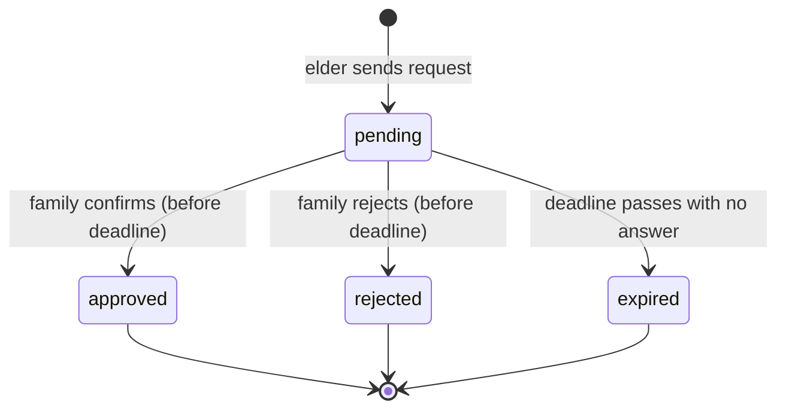
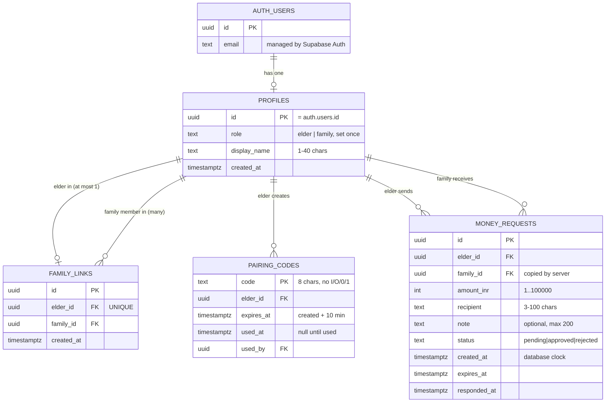
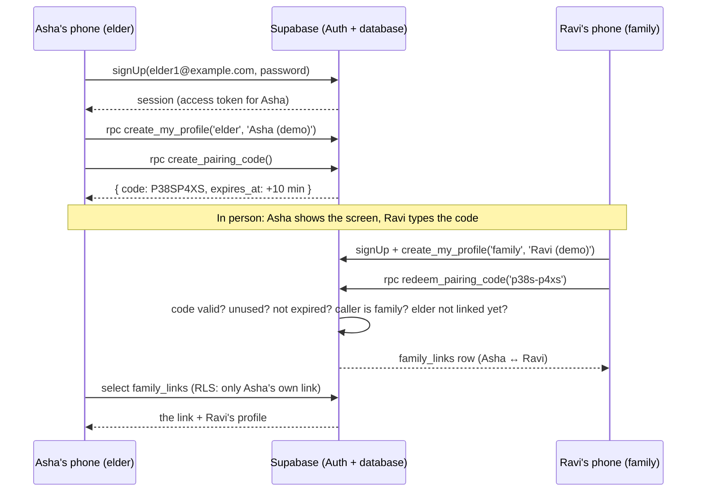
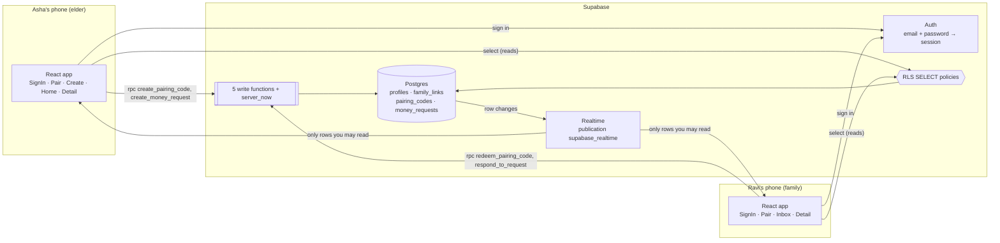

# Flod — Learning Guide

This guide teaches you to rebuild Flod **from an empty folder without AI**. It was written phase by phase, so the detailed sections below are grouped by phase (the order things were built). **To learn a topic, follow the reading path:** it lists every topic in the order you need it, and where each part is.

## Reading path (topic order)

| # | Topic | Read these parts | Status |
|---|---|---|---|
| 1 | Prerequisites and environment setup | §1 (Phase 1); §11 "Environment variables" | ✅ |
| 2 | JavaScript and TypeScript basics used by the app | §2 (Phase 1); Phase 4 "discriminated union / narrowing"; Phase 5 "Promises and async/await", "`{ data, error }`" | ✅ |
| 3 | React components, props, state, events and forms | §3 (Phase 1); Phase 2 "New React concepts"; Phase 4 "Context", "Async event handlers"; Phase 6 `useCallback` | ✅ |
| 4 | Request/domain types and state transitions | §4 (Phase 1); Phase 2 "Request states and transitions"; Phase 6 "never go backwards" | ✅ |
| 5 | SQL schema, relations, constraints and migrations | Phase 3 §5; Phase 6 "publication" (`0004`); Phase 7 `0005` | ✅ |
| 6 | Authentication, roles, pairing and authorization | Phase 3 §6–7; Phase 4 §6 (sessions, roles, pairing codes, sequence diagram) | ✅ |
| 7 | Row Level Security and safe approval/rejection | Phase 3 §6–7 (policies, functions); Phase 6 §7 (conditional update, confirmed UI) | ✅ |
| 8 | Request lifecycle and database reads/writes | Phase 2 data-flow walkthrough (mock); Phase 5 §8 (real) | ✅ |
| 9 | Realtime subscriptions or polling and cleanup | Phase 6 §9 | ✅ |
| 10 | Timeout, visual/audio warnings and failure handling | Phase 7 §10 + failure-mode table | ✅ |
| 11 | Tests, debugging, deployment and environment variables | §11 "Tests and scripts" (Phase 1); **§11 (complete)** near the end | ✅ (hosting itself: Phase 9) |
| 12 | Diagrams, glossary, common errors, exercises, rebuild checklist, judge Q&A | **§12** near the end; each phase's exercises and self-test | ✅ |
| 13 | **Notme:** what changed from Flod and why | **Part B** §13 (at the very end) | ✅ onsite Phase 1 |
| 14 | Capacitor: a web app inside an Android app | Part B §14 | ✅ onsite Phase 2 |
| 15 | Push notifications: FCM, tokens, channels, permission | Part B §15 | ✅ onsite Phase 3 |
| 16 | Supabase Edge Functions and server-only secrets | Part B §16 | ✅ onsite Phase 4 |
| 17 | Testing on real Android phones and failure modes | Part B §17 | ⏳ Phase 5 |
| 18 | Disclosure: pre-event vs onsite, and how git shows it | Part B §18 | ⏳ outline now; complete in Phase 6 |

**Part A (everything above Part B) teaches Flod**, the pre-event web prototype that Notme is built on. **Part B teaches what was added onsite** to turn it into the Notme Android app.

Every major file is explained (what, why, inputs/outputs, important parts, common mistakes, practice task) in the "file-by-file" table of the phase that created it. **Appendix: file index** near the end says which table to look in.

A longer, chapter-by-chapter book about the same design is in `Learning/` (it calls the product "Notme"; not part of the Git repo).

---

## The big picture (read first)

Flod has one job: before an elder pays an urgent request, a family member **they linked in advance** confirms the exact amount and recipient on **their own device**. Each request is in one of four states:

| State | Meaning | What the elder should do |
|---|---|---|
| `pending` | Waiting for the family member | Wait. Don't pay yet. |
| `approved` | Family member confirmed these exact details | Proceed carefully. Approval doesn't prove the recipient is safe. |
| `rejected` | Family member says this request is not genuine | Don't pay. Call them on a known number. |
| `expired` | No answer before the deadline | **Unconfirmed** (not proven fraud). Don't pay until you reach them. |

---

## 1. Prerequisites and environment setup  *(Phase 1)*

**Install:** Node.js LTS (includes npm), Git, a code editor (VS Code). Check them:

```bash
node --version
npm --version
git --version
```

**Create the project from nothing (what Phase 1 did):**

```bash
npm create vite@latest flod -- --template react-ts
cd flod
npm install
npm install -D vitest jsdom @testing-library/react @testing-library/jest-dom
npm run dev
```

Then add the `typecheck` and `test` scripts to `package.json` (see section 11) and the `test` block in `vite.config.ts`.

**Git, first time on a computer:**

```bash
git config --global user.name "Your Name"
git config --global user.email "you@example.com"
git init
git add .
git commit -m "Initial scaffold"
```

### Concept: Node and npm
- **Node.js** runs JavaScript *outside* the browser. Our tools (Vite, TypeScript, Vitest) are JavaScript programs, so they need Node.
- **npm** is Node's package manager: it downloads libraries listed in `package.json` into `node_modules/`.
- **Analogy:** `package.json` is a shopping list, npm is the person who goes shopping, and `node_modules/` is the pantry. You never commit the pantry to Git; anyone can rebuild it from the list with `npm install`.
- `package-lock.json` records the *exact* versions bought, so every teammate gets identical packages. Commit it.

### Concept: Vite
- During development, `npm run dev` starts a local web server that serves our files and **reloads the page instantly** when you save.
- For production, `npm run build` bundles everything into a few small files in `dist/` that any static host can serve.
- **Analogy:** Vite is the kitchen. You cook (edit) in the kitchen; `build` packs the finished meal into boxes for delivery.

---

## 2. JavaScript and TypeScript basics used so far  *(Phase 1)*

| Feature | Example from our code | Meaning |
|---|---|---|
| `const` | `const now = Date.now()` | A name that won't be reassigned |
| Arrow function | `(n: number) => new Date(now + n * 60_000)` | A short way to write a function |
| Template literal | `` `status-badge status-${status}` `` | A string with a value inserted |
| Destructuring | `const { icon, label } = STATUS_LABELS[status]` | Pull named fields out of an object |
| Array `.filter` | `mockRequests.filter((r) => r.elderId === mockElder.id)` | Keep only the items that pass a test |
| Array `.map` | `requests.map((request) => <li …>)` | Turn each item into something else |
| Array `.find` | `mockRequests.find((r) => r.id === view.requestId)` | First matching item, or `undefined` |
| `??` | `familyMember?.displayName ?? 'your family member'` | Use the right side if the left is `null`/`undefined` |
| `?.` | `familyMember?.displayName` | Read a field only if the object exists |
| `import` / `export` | `export function formatInr…` / `import { formatInr } from '../lib/format'` | Share code between files |

### TypeScript types
TypeScript adds **labels describing what shape data has**. The editor and `npm run typecheck` then catch mistakes before the app runs.

```ts
// src/types/domain.ts
export type RequestStatus = 'pending' | 'approved' | 'rejected' | 'expired'

export interface MoneyRequest {
  id: string
  amountInr: number
  note: string | null   // either text or nothing
  status: RequestStatus
  // …
}
```

- A **union type** (`'a' | 'b'`) means "only one of these exact values". Writing `status: 'aproved'` (typo) is a compile error.
- An **interface** describes an object's fields.
- `string | null` means the value may be missing; TypeScript forces you to handle that case.
- **Analogy:** types are the labelled slots in a pill organiser. You can't put Tuesday's pill in the Friday slot without noticing.

**Discriminated union** (`src/types/view.ts`): every option has a `name`. After checking `view.name === 'requestDetail'`, TypeScript *knows* `view.requestId` exists.

---

## 3. React components, props, state and events  *(Phase 1; forms in Phase 2)*

### Components and JSX
A **component** is a function that returns what should appear on screen. The HTML-like syntax inside is **JSX**.

```tsx
// src/components/StatusBadge.tsx (simplified)
export function StatusBadge({ status }: StatusBadgeProps) {
  const { icon, label } = STATUS_LABELS[status]
  return (
    <span className={`status-badge status-${status}`}>
      <span aria-hidden="true">{icon}</span> {label}
    </span>
  )
}
```

JSX rules to remember:
- Use `className`, not `class`. Use `htmlFor` on labels, not `for`.
- `{ }` inserts a JavaScript value.
- A component name starts with a capital letter: `<StatusBadge />`.
- A component returns **one** parent element (or a fragment `<>…</>`).

### Props: inputs to a component
Props are arguments passed from parent to child, like function parameters.

```tsx
<RequestCard request={request} onOpen={onOpenRequest} />
```

`RequestCard` receives `request` (data) and `onOpen` (a function to call when tapped). **Data flows down through props; events flow up through callback functions.**

**Analogy:** props are an order slip handed to a cook. The cook can't change the slip; they just cook from it.

### State: memory that changes the screen
```tsx
// src/App.tsx
const [role, setRole] = useState<UserRole>('elder')
const [view, setView] = useState<View>({ name: 'elderHome' })
```

- `useState` returns the current value and a setter.
- Calling the setter (`setView(...)`) makes React **re-run the component** and update the screen.
- Never change state directly (`view.name = 'x'` won't update the screen).
- **Analogy:** state is the whiteboard in a shop. When someone rewrites it, everyone looks up and updates what they're doing.

### Events
```tsx
<button type="button" onClick={() => onSwitchRole('family')}>Family</button>
```

`onClick` receives a function that React calls when the button is pressed. In `CreateRequest.tsx`, `onSubmit` calls `event.preventDefault()` so the browser doesn't reload the page.

### Conditional rendering
```tsx
{requests.length === 0 ? <p>No requests…</p> : <ul>…</ul>}
{needsWarning && viewerRole === 'elder' && <div role="alert">…</div>}
```

### Lists and keys
```tsx
{requests.map((request) => (
  <li key={request.id}>…</li>
))}
```

`key` lets React track which item is which. Use a stable ID, not the array index.

### CSS (plain, mobile-first)
- All styles are in `src/styles/global.css`, imported once in `main.tsx`.
- **Mobile-first:** the base rules are for a ~375 px phone, and `@media (min-width: 48rem)` adds desktop tweaks.
- **Design tokens:** colours live in `:root` as variables (`--color-primary`) and are used with `var(--color-primary)`. Change once, update everywhere.
- **Accessibility built in:**
  - 18 px base text and 48 px minimum tap height;
  - a visible `:focus-visible` outline;
  - status shown with **words + symbol**, not colour alone;
  - a "Skip to main content" link.

---

## 4. Domain types  *(types in Phase 1; transitions in Phase 2)*

- `UserRole = 'elder' | 'family'`
- `RequestStatus = 'pending' | 'approved' | 'rejected' | 'expired'`
- `MoneyRequest`: one request. `amountInr` is a **whole number of rupees**, because decimals in JavaScript can round badly (`0.1 + 0.2` gives `0.30000000000000004`).
- `expired` is **calculated** from `expiresAt`, not stored (see Phase 2 below).
- `StoredStatus` = what is saved (`pending | approved | rejected`); `RequestStatus` = what is shown (adds `expired`).

---

## 11. Tests and scripts  *(started Phase 1)*

| Script | Command it runs | Why |
|---|---|---|
| `npm run dev` | `vite` | Local dev server |
| `npm run lint` | `oxlint` | Finds suspicious code (e.g. breaking React's hook rules) |
| `npm run typecheck` | `tsc -b` | Type errors across the whole project |
| `npm test` | `vitest run` | Runs all `*.test.ts(x)` files once |
| `npm run build` | `tsc -b && vite build` | Typecheck, then build `dist/` |

**How a component test works** (Phase 1 example; the Family switch it clicks was removed in Phase 4, and today's tests are described in "§11 (complete)" near the end):
```tsx
render(<App />)                                               // draw it in a fake browser (jsdom)
fireEvent.click(screen.getByRole('button', { name: 'Family' }))  // act like a user
expect(screen.getByRole('heading', { name: /requests to confirm/i })).toBeInTheDocument()  // check
```

We find elements **by role and visible text**, the way a user (or screen reader) would. If a test can't find a button by its name, a blind user probably can't either.

---

## Phase 1 file-by-file

| File | What it does / why it exists | Inputs → outputs | Common mistakes | Practice task |
|---|---|---|---|---|
| `package.json` | Project name, scripts, dependency list | — | Editing `node_modules` by hand; forgetting to commit `package-lock.json` | Add a script `"hello": "echo hi"` and run `npm run hello` |
| `vite.config.ts` | Vite plugins + Vitest settings (jsdom, setup file) | — | Forgetting `environment: 'jsdom'` → "document is not defined" in tests | Find where the setup file path is set |
| `tsconfig*.json` | TypeScript settings: `app` for `src/`, `node` for config files | — | Turning off `strict` checks to "fix" errors | Find which file includes the `src` folder |
| `.oxlintrc.json` | Lint rules (React hooks, TypeScript) | — | Ignoring warnings | Read the two React rules and explain them |
| `index.html` | The single HTML page; `<div id="root">` is where React draws | — | Removing the `root` div | Change the `<title>` and watch the tab update |
| `src/main.tsx` | Starts React: finds `#root`, renders `<App />`, imports CSS | — | Importing CSS twice | Explain what `StrictMode` is for (look it up) |
| `src/App.tsx` | Holds `role` + `view` state, chooses the page, filters mock data | state → which page shows | Calling `setView` directly instead of `goTo` (skips scroll-to-top) | Make the app start on the Safety page |
| `src/types/domain.ts` | Shared data shapes | — | Using `number` for status instead of a union | Add `'cancelled'` to `RequestStatus` and follow the type errors (then undo) |
| `src/types/view.ts` | Which screens exist | — | Adding a screen here but not in `App.tsx`'s `switch` | — |
| `src/mock/mockData.ts` | Synthetic profiles + 4 requests (one per status) | — | Using real names/UPI IDs | Add a 5th pending request |
| `src/lib/format.ts` | `formatInr`, `formatDateTime` using `Intl` | number/ISO string → readable text | Hand-writing commas (Indian grouping is 1,00,000) | Add `formatShortDate` |
| `src/components/Layout.tsx` | Header, demo banner, demo role switch, nav, `<main>` | role, current view, callbacks, children | Using `<div onClick>` instead of `<button>` (keyboard users can't press it) | Add a footer line |
| `src/components/StatusBadge.tsx` | Status as text + symbol | `status` → badge | Showing colour only | Change an icon |
| `src/components/RequestCard.tsx` | Tappable summary of one request | `request`, `onOpen` | Putting `<div>` inside `<button>` (invalid HTML; we use `<span>`) | Show the note on the card |
| `src/pages/ElderHome.tsx` | Greeting, main action, elder's requests | elder, family, requests, callbacks | Forgetting the empty state | — |
| `src/pages/CreateRequest.tsx` | Page around the form (Phase 2: the form itself moved to `RequestForm`) | family, `onSubmit`, `onCancel` | Inputs without `<label htmlFor>` | — |
| `src/pages/FamilyInbox.tsx` | Requests assigned to the family member | family, requests, `onOpenRequest` | — | — |
| `src/pages/RequestDetail.tsx` | Full details + warning for rejected/expired (elder view) | request, people, viewer role | Wording that claims "scam" or "safe" | — |
| `src/pages/AboutSafety.tsx` | What answers mean, what Flod does NOT do | — | Overclaiming | — |
| `src/styles/global.css` | All styling, mobile-first | — | Fixed pixel widths that overflow phones | — |
| `src/test/setup.ts` | Test helpers: jest-dom matchers, cleanup, `scrollTo` stub | — | — | — |
| `*.test.ts(x)` | Automated checks | — | Testing CSS class names instead of what the user sees | — |
| `.gitignore` | Keeps `node_modules`, `dist`, `.env*` out of Git | — | Committing `.env.local` | — |
| `.env.example` | Placeholder names for Phase 4 settings | — | Putting real keys here | — |

---

## How to add a small component without AI (recipe)

1. **Decide the props.** What does it need from its parent? Write them as an interface.
2. **Create the file** `src/components/MyThing.tsx`:
   ```tsx
   interface MyThingProps {
     text: string
   }

   export function MyThing({ text }: MyThingProps) {
     return <p className="my-thing">{text}</p>
   }
   ```
3. **Use it** in a page: `import { MyThing } from '../components/MyThing'`, then `<MyThing text="Hello" />`.
4. **Style it** in `global.css` with `.my-thing { … }`.
5. **Check:** `npm run typecheck` (did you pass the right props?), `npm run lint`, then look in the browser.
6. **Test it** (optional): copy `StatusBadge.test.tsx`, render your component, and `expect` the text.

---

## Phase 1 exercises (do these without AI)

1. **Footer.** Create `src/components/Footer.tsx` that shows "Flod prototype · synthetic data". Render it at the bottom of `Layout`, style it with small muted text, and make sure `npm run lint`, `npm run typecheck` and `npm test` still pass.
2. **New mock request.** Add a fifth mock request for ₹999 with status `pending`. Where does it appear, and why does it appear in *both* the elder and family lists?
3. **Break it on purpose.** In `RequestCard.tsx`, change `request.amountInr` to `request.amount`. Run `npm run typecheck`. Read the error and explain it in your own words, then undo the change.
4. **Test it.** Write a test that switches to Family, opens the ₹25,000 request, and checks that a "Confirm request" button appears. (Updated after Phase 2 added the buttons.)

*(Answers aren't included. Try first, then ask a teammate or your reviewer.)*

## Phase 1 self-test

1. What does `npm install` read, and where does it put things?
2. What is the difference between a prop and state?
3. Why does `RequestCard` receive an `onOpen` function instead of changing the view itself?
4. Why is `amountInr` a whole number?
5. What does `key={request.id}` do?
6. Why are statuses shown with words and symbols, not just colours?
7. What file decides which page is visible?
8. Why does `.env.example` exist if `.env` files are ignored by Git?

---

---

# Phase 2 — The request lifecycle with local mock data

## Request states and transitions (section 4, continued)



Rules (in `src/mock/mockStore.ts`, later in the database):
- A request **always starts** as `pending`. The elder can't choose its status.
- Only the **linked family member** may answer, and only **once**, and only **before the deadline**.
- Answers are final: nothing moves back to `pending`.
- `expired` is **derived**, never saved. The saved status stays `pending`, and `getEffectiveStatus()` says "expired" once `now >= expiresAt`. A derived value can't go out of date: no timer has to remember to flip it.

**Analogy:** a milk carton doesn't change its label at midnight. You compare the printed date with today's date when you look at it. `expiresAt` is the printed date; `getEffectiveStatus` does the comparing.

## New React concepts (section 3, continued)

### Controlled inputs
In a **controlled** input, React state is the single source of truth. The input only shows what state says, and every keystroke updates state.

```tsx
// src/components/RequestForm.tsx
const [values, setValues] = useState<RequestFormValues>({ amount: '', recipient: '', note: '' })

<input
  id="amount"
  value={values.amount}                                           // state → screen
  onChange={(event) => updateField('amount', event.target.value)} // screen → state
/>
```

**Analogy:** a scoreboard operator. The board (input) shows only what the operator (state) writes. If you forget `onChange`, the input is "frozen", because typing never reaches the operator.

### Events
- `onChange` fires on every keystroke and gives you `event.target.value` (always a **string**, even in a number field).
- `onSubmit` on the `<form>` fires on button click **or** Enter. Call `event.preventDefault()` or the browser reloads the page and your state is lost.
- `onClick` on buttons. Always use `<button type="button">` unless it should submit a form.

### Form validation
`validateRequestForm(values)` in `src/lib/validation.ts` is a **pure function**: text in, verdict out. It touches no React and no screen, so it's easy to test.

```ts
validateRequestForm({ amount: '25,000', recipient: 'shop@demo-upi', note: '' })
// → { ok: true, data: { amountInr: 25000, recipient: 'shop@demo-upi', note: null } }

validateRequestForm({ amount: '-50', recipient: '', note: '' })
// → { ok: false, errors: { amount: 'Use whole rupees…', recipient: 'Enter who you are…' } }
```

- It returns a **result object** (`ok: true` with clean data, or `ok: false` with messages) instead of throwing errors. TypeScript then forces callers to handle both cases.
- **Browser validation is for kindness, not security.** Anyone can skip it (for example with the browser's dev tools). Phase 3 repeats these limits in the database, where they can't be skipped.
- Accessibility: errors are text (never only a red border); `aria-invalid` and `aria-describedby` connect each error to its input; focus jumps to the first problem.

### State updates must create new values (immutability)
React only notices a change when you give it a **new** object or array.

```ts
// ✅ new object: copy the old fields, overwrite one
setValues((previous) => ({ ...previous, [field]: value }))

// ✅ new array with one item replaced
requests.map((r) => (r.id === requestId ? updated : r))

// ❌ mutating: same array object, so React may not re-render
requests[0].status = 'approved'
```

`setValues((previous) => …)` is the **functional update** form. It always uses the latest state, which is safer when an update depends on the previous value.

### Lifting state up
The elder screen and the family screen must see the **same** list. So the list lives in their common parent, `App.tsx`, and goes down to each page as a prop:

```
App  ── requests (state) ──┬──> ElderHome / RequestDetail (elder view)
                           └──> FamilyInbox / RequestDetail (family view)
        ▲
        └── handleCreate / handleRespond (callbacks): the only places that change it
```

### Conditional rendering, three ways
```tsx
{errors.amount && <p className="field-error">{errors.amount}</p>}       // && : show or nothing
{waiting.length === 0 ? <p>Nothing is waiting…</p> : <ul>…</ul>}        // ? : : one or the other
switch (status) { case 'pending': return …; case 'approved': return … } // many options (StatusBanner)
```

Using `switch` on a union type has a bonus: if someone adds a fifth status, TypeScript complains about every `switch` that forgot it.

### Effects and cleanup (preview of Phases 6–7)
`useNow()` (in `src/hooks/useNow.ts`) starts a 1-second timer with `useEffect` and **returns a cleanup function** that stops it:

```ts
useEffect(() => {
  const timerId = setInterval(() => setNow(Date.now()), 1000)
  return () => clearInterval(timerId) // runs when the component disappears
}, [])
```

Forgetting the cleanup leaves timers running forever. That's a classic bug, and it matters again for Realtime subscriptions in Phase 6.

## Why local state can't synchronise two devices

React state lives **in the memory of one browser tab**. Your phone and your relative's phone each run their own copy of the app with their own memory. When Asha's phone runs `setRequests(...)`, nothing travels over the internet; Ravi's phone has no idea it happened. Even two tabs on the same laptop don't share state, and reloading wipes it.

**Analogy:** two people each writing on their own notepad. To share, you need a **shared noticeboard** that both can read and write: a database on a server. That's Supabase, from Phase 3. Then live updates (Phase 6) are like the noticeboard ringing a bell when something changes.

That's why the header says "kept only in this browser tab", and why the demo uses the Elder/Family switch in one tab.

## Data-flow walkthrough: one request, start to finish

1. **Elder types.** Each keystroke runs `updateField` and `setValues`, then React re-renders the form. Values are strings: `amount = "2500"`.
2. **Elder taps "Send to family to confirm".**
   - The `<form onSubmit>` runs `handleSubmit`, which calls `preventDefault()`.
   - `validateRequestForm(values)` returns `{ ok: true, data: { amountInr: 2500, … } }`.
   - `onSubmit(data)` passes it up to the `CreateRequest` page, then up to `App.handleCreate`.
3. **`App.handleCreate`** calls `createRequest(requests, input, link, Date.now())`.
   - That returns a **new** array with a `pending` request whose `expiresAt` is now + 60 s.
   - `setRequests(newArray)` saves it, and `openRequest(created.id)` shows its detail page.
4. **Re-render.** `RequestDetail` calls `getEffectiveStatus(request, nowMs)`, which returns `pending`, so `StatusBanner` shows "Waiting for Ravi… Do not pay yet."
5. **Switch to Family.**
   - `role` becomes `family`, and the same request stays open.
   - `RequestDetail` now shows `FamilyResponse` with Confirm and Reject buttons, because the status is `pending`.
6. **Ravi taps "Reject request".**
   - `answer('rejected')` calls `onRespond`, which reaches `App.handleRespond`, which calls `respondToRequest(...)`.
   - The checks pass (it exists, it's Ravi's, it's pending, it isn't expired), so it returns a new array with `status: 'rejected'` and `respondedAt` set.
   - `setRequests(...)` saves it, the buttons disappear, and the outcome message appears.
7. **Switch to Elder.** The status is `rejected`, so `StatusBanner` renders `WarningPanel` with the "Pause…" warning (`role="alert"`).
8. **Alternative: nobody answers.** Every second `useNow` ticks and the app re-renders. Once `nowMs >= expiresAt`, the status becomes `expired`, and the elder sees the warning saying no reply is not proof of a scam.

## Phase 2 file-by-file

| File | What / why | Inputs → outputs | Important parts | Common mistakes | Practice task |
|---|---|---|---|---|---|
| `src/config.ts` | One place for the demo timeout | — | `REQUEST_TIMEOUT_SECONDS` | Hard-coding `60` in several files | Change it to 20 and watch a request expire |
| `src/lib/validation.ts` | Turns raw form text into clean data or friendly errors | `RequestFormValues` → `ValidationResult` | regex `/^\d+$/`, limit constants | `Number('')` gives `0`; `parseInt('12abc')` gives `12` | Reject recipients containing spaces |
| `src/lib/requestStatus.ts` | Works out the status to show | request + now → `RequestStatus` | `getEffectiveStatus`, `canBeAnswered` | Saving "expired" in state and forgetting to update it | Add `secondsLeft(request, now)` |
| `src/mock/mockStore.ts` | Local stand-in for database rules | list + action → new list or error | `createRequest`, `respondToRequest` | Mutating the old array; forgetting the "already answered" check | Write `cancelRequest` (exercise 1) |
| `src/hooks/useNow.ts` | A clock that re-renders every second | interval → current ms | `useEffect` + cleanup | No `clearInterval` | Make it tick every 5 s and observe |
| `src/components/RequestForm.tsx` | Controlled form, shows errors | callbacks → `NewRequestInput` | `updateField`, `handleSubmit` | Missing `preventDefault`; `value` without `onChange` | Add a character counter for the recipient |
| `src/components/StatusBanner.tsx` | Elder's message for each status | status, name → banner | `switch` on status | Saying "safe" or "scam" | Change the pending wording |
| `src/components/WarningPanel.tsx` | The big "Pause." warning | reason, name → alert | `role="alert"`, one-paragraph sentence | Relying on colour or sound only | — |
| `src/components/FamilyResponse.tsx` | Confirm/Reject, error, outcome | status, callback → buttons/message | local `error` state | Showing buttons for non-pending requests | — |
| `src/App.tsx` | Owns the shared `requests` state | — | `handleCreate`, `handleRespond`, `switchRole` | Changing `requests` anywhere else | — |
| `*.test.ts(x)` | Prove validation, transitions, wording and the full flow | — | fake timers in `App.test.tsx` | Testing implementation details instead of behaviour | Add a test for a 201-character note |

## Phase 2 exercises (no AI; answers aren't included)

1. **Add a "Cancel request" action (mock data only).** The elder should be able to cancel their own request while it's still pending.
   - Add a status for it (think about `StoredStatus`, `RequestStatus`, `StatusBadge` labels, and every `switch` TypeScript then complains about).
   - Write `cancelRequest(requests, requestId, elderId, nowMs)` in `mockStore.ts` with the same style of checks as `respondToRequest`. Who may cancel? What if it's already answered or expired?
   - Add a "Cancel this request" button for the elder, shown only while pending, and the message the family member sees afterwards.
   - Write at least two tests: cancelling works; cancelling an approved request is refused.
2. **Trace by hand.** On paper, follow what happens when Ravi taps **Confirm** and then the request is somehow answered again. Which line in `respondToRequest` stops the second answer from changing anything?
3. **Validation edge cases.** Predict the result of `validateRequestForm` for amounts `"007"`, `"1,00,000"`, `" 5 "` and `"१०००"` (Devanagari digits). Then write tests to check your predictions.
4. **Two tabs.** Open the app in two tabs. Create a request in one. Explain in two sentences why the other tab doesn't show it.

## Phase 2 self-test

1. What makes an input "controlled"?
2. Why does `handleSubmit` call `event.preventDefault()`?
3. Why is `expired` calculated instead of saved?
4. Why must `respondToRequest` return a **new** array?
5. Where does the `requests` state live, and why there?
6. What would happen if `useNow` didn't return a cleanup function?
7. Why isn't browser-side validation enough for security?
8. What exactly does "Confirmed by family" promise, and what does it **not** promise?


---

---

# Phase 3 — The database: schema, Row Level Security and safe functions

The app doesn't use the database yet (that's Phases 4–6). This phase builds and checks the foundation.

## 5. SQL schema, relations, constraints and migrations

### Tables, rows, columns
A **table** is like a spreadsheet tab with strict rules. Each **column** has a name and a type; each **row** is one record.

`money_requests` (one row = one request):

| id | elder_id | family_id | amount_inr | recipient | status | created_at | expires_at | responded_at |
|---|---|---|---|---|---|---|---|---|
| 7c1e… | a1… | b2… | 2500 | test.shop@demo-upi | pending | 10:00:00 | 10:01:00 | *null* |

Compare it with the TypeScript `MoneyRequest` in `src/types/domain.ts`. It's the same shape, with `snake_case` names instead of `camelCase`. Phase 5 converts between them.

### Our schema



### Keys
- **Primary key (PK):** the column that uniquely identifies a row, like a roll number. `money_requests.id` is a random UUID made by the database (`default gen_random_uuid()`).
- **Foreign key (FK):** a column that must match a row in another table. `money_requests.elder_id references profiles(id)` means you can't create a request for an elder who doesn't exist.
- **`on delete cascade`:** if the parent row is deleted, delete the children too. Deleting a user removes their profile, links, codes and requests, so nothing is left orphaned.

**Analogy:** the PK is a student's roll number. An FK is "roll number written on an exam paper"; the school checks that the student really exists.

### Constraints: rules the database enforces, whoever is asking
| Constraint | Where | What it stops |
|---|---|---|
| `not null` | most columns | Missing data |
| `check (amount_inr between 1 and 100000)` | money_requests | Zero, negative or huge amounts, even if someone skips the form |
| `check (status in ('pending','approved','rejected'))` | money_requests | Made-up statuses |
| `check ((status = 'pending') = (responded_at is null))` | money_requests | "Approved" with no answer time, or "pending" with one |
| `unique (elder_id)` | family_links | A second trusted relative for the same elder |
| `check (elder_id <> family_id)` | links, requests | Linking to yourself |
| `check (code ~ '^[A-HJ-NP-Z2-9]{8}$')` | pairing_codes | Badly formed codes |

These repeat `src/lib/validation.ts` on purpose. **Browser checks are for kindness; database checks are for safety.**

### Migrations
A **migration** is a numbered SQL file that changes the database's structure. You run them in order (`0001` → `0002` → `0003`), and they live in Git like any other code, so every teammate (and the judges) can rebuild the same database and review every change.
- Ours are **re-runnable**: `create table if not exists`, `drop policy if exists` then `create policy`, `create or replace function`. Running a file twice is harmless.
- **Rule:** once a migration has been applied to a shared database, don't edit it. Add `0004_…` instead (Phase 6 will add `0004_realtime.sql`).

## 6–7. Authentication vs authorization, and Row Level Security

- **Authentication** answers "who are you?". Supabase Auth checks the email and password and gives the browser a signed **token** containing the user's id. In SQL, `auth.uid()` reads that id.
- **Authorization** answers "what may you do?". That's our job: RLS policies and the checks inside the functions.
- **Analogy:** authentication is the ID check at the building entrance. Authorization is which rooms your key card opens.

### Two locks on every table
1. **Grants** (table-level): `revoke all … from anon, authenticated` then `grant select … to authenticated`. Logged-out visitors can't touch the tables at all; signed-in users can only *read*.
2. **RLS policies** (row-level): *which* rows they can read. With RLS enabled and no matching policy, you see **zero rows**, so the default is "deny".

### Our five policies, translated into plain English
| Policy | SQL condition | Plain English |
|---|---|---|
| profiles: read own | `id = auth.uid()` | You can see your own profile. |
| profiles: read linked person | exists a `family_links` row joining you and them | You can see the name of the one person you're linked with, and no one else. |
| family_links: read if member | `elder_id = auth.uid() or family_id = auth.uid()` | You can see a link only if you're one of its two people. |
| pairing_codes: read own | `elder_id = auth.uid()` | Only the elder who created a code can see it. |
| money_requests: read if elder or assigned family | `elder_id = auth.uid() or family_id = auth.uid()` | A request is visible to its elder and its assigned family member, nobody else. |

`(select auth.uid())` is written with `select` so Postgres works out the user id once per query instead of once per row (faster, same result).

### Why writes go through functions, not UPDATE policies
If we gave family members an UPDATE policy "you can update requests sent to you", they could change **any column** of those rows: the amount, the recipient, or the status back to `pending`. RLS decides *which rows*, not *which columns or values*. So instead:

- There are **no** INSERT, UPDATE or DELETE rights for users at all.
- Five small functions each do **one** job and check everything themselves.
- They are `security definer`: they run with the table owner's rights, like a bank teller who can open the vault but follows strict rules for each customer.
- `set search_path = ''` and fully qualified names (`public.money_requests`) stop anyone tricking the function into using a look-alike table.
- EXECUTE is granted to `authenticated` only; logged-out visitors can't call them.

### The approve/reject function, line by line
```sql
update public.money_requests
set status = p_decision, responded_at = now()   -- only these two columns can change
where id = p_request_id
  and family_id = v_uid          -- only the assigned family member (not the elder, not a stranger)
  and status = 'pending'         -- only once; can never go back to pending
  and expires_at > now()         -- not after the deadline (database clock, not the phone's)
returning * into v_row;
```

If two answers arrive at the same moment, Postgres locks the row. The second `UPDATE` waits, then re-checks `status = 'pending'`, finds it false, and changes nothing. If no row matched, the function explains why, but says "Request not found" to strangers so it doesn't reveal that the request exists.

## Example queries

Run these in the Supabase SQL Editor. As the owner you see everything, because RLS doesn't apply to the table owner.

```sql
-- All requests, newest first, with names
select r.amount_inr, r.recipient, r.status, e.display_name as elder, f.display_name as family
from public.money_requests r
join public.profiles e on e.id = r.elder_id
join public.profiles f on f.id = r.family_id
order by r.created_at desc;

-- Which requests are effectively "expired" right now?
select id, amount_inr from public.money_requests
where status = 'pending' and expires_at <= now();

-- Pretend to be a signed-in user (this is how rls_checks.sql works). Inside a transaction:
begin;
select set_config('role', 'authenticated', true);
select set_config('request.jwt.claims', '{"sub":"<a user id>","role":"authenticated"}', true);
select count(*) from public.money_requests;   -- now filtered by RLS
rollback;
```

How the app will call the functions later (Phase 4–6 preview; not in the code yet):
```ts
await supabase.rpc('create_money_request', {
  p_amount_inr: 2500,
  p_recipient: 'shop@demo-upi',
  p_note: null,
  p_timeout_seconds: 60,
})
await supabase.rpc('respond_to_request', { p_request_id: id, p_decision: 'approved' })
```

## How the security was tested
`supabase/checks/rls_checks.sql` creates four throwaway users (Elder A, Family B linked to A, Stranger C, Elder D). It plays each one and tries 36 allowed or forbidden actions. Each result is recorded as PASS or FAIL.

To check that the checks themselves work, we ran them against a **deliberately broken** copy (RLS turned off, UPDATE allowed). They correctly reported FAIL. A test that never fails proves nothing.

Honesty note: so far this ran on PGlite (real PostgreSQL in WebAssembly) with a stand-in for Supabase's auth pieces, **not** on a real Supabase project. Running it on yours is README step 4.

## Phase 3 file-by-file

| File | What / why | Important parts | Common mistakes | Practice task |
|---|---|---|---|---|
| `0001_tables.sql` | Structure + rules for data | FKs with `on delete cascade`, `check` constraints, indexes | Forgetting `not null`; using `float` for money | Add a `check` that `recipient` has no leading/trailing spaces |
| `0002_rls.sql` | Who can read which rows | `enable row level security`, `revoke`/`grant`, 5 policies | Enabling RLS but leaving broad grants; adding an UPDATE policy "to make it work" | Write the policy for "elders can read their own pairing codes" from memory |
| `0003_functions.sql` | The only write paths | `auth.uid()` checks, conditional `UPDATE`, `security definer`, `search_path = ''`, grants | Forgetting to revoke EXECUTE from `anon`; trusting a user id passed as a parameter | Explain why `create_money_request` has no `p_family_id` parameter |
| `rls_checks.sql` | Proves the rules | `act_as()`, `begin … exception … end` blocks | Only testing the "happy path" | Add a check: stranger C cannot redeem elder D's fresh code after it's used |

## Phase 3 exercises (no AI; answers aren't included)

1. **Policies in plain English.** Cover the table above. For each of the five policies in `0002_rls.sql`, write one plain-English sentence about who can see what. Then check yourself against the table.
2. **Predict, then check.** For each scenario, say "rows visible", "error" or "allowed", and which line of SQL decides it:
   - Stranger C runs `select * from money_requests`.
   - Family B runs `update money_requests set amount_inr = 1`.
   - Elder A calls `respond_to_request(<A's own request>, 'approved')`.
   - Family B calls `respond_to_request` 2 minutes after the deadline.
   - A logged-out visitor calls `create_pairing_code()`.
3. **Break it on purpose (local or a throwaway project only).** Comment out the `and status = 'pending'` line in `respond_to_request`, re-run `0003`, then run `rls_checks.sql`. Which check fails, and why? Restore the line afterwards.
4. **Design question.** Write half a page: what would go wrong if `money_requests` had the policy `for update using (family_id = auth.uid())` instead of our function? Give two concrete attacks.

## Phase 3 self-test
1. What's the difference between a primary key and a foreign key? Give one example of each from our schema.
2. Why is `amount_inr` an `integer` with a `check`, and why repeat the browser's validation here?
3. Authentication vs authorization: which one does `auth.uid()` give you, and which one do policies provide?
4. With RLS enabled and no policies, what does a signed-in user see?
5. Why do users have SELECT but no INSERT, UPDATE or DELETE?
6. What does `security definer` mean, and what two precautions do we take because of it?
7. How does `respond_to_request` stop a duplicate answer, even if two arrive at the same instant?
8. Why does the server, not the browser, choose `family_id` and `expires_at`?


---

# Phase 4 — Authentication and trusted-family pairing

What changed: the app now has **real accounts** (Supabase Auth), a **role chosen once**, and **pairing with a one-time code**. Money requests are still the local mock store from Phase 2; Phase 5 moves them into the database.

## 6. Authentication, roles, pairing and authorization (section 6, continued)

### Sessions and tokens
When you sign in, Supabase checks your email and password and gives the browser a **session**: an **access token** (a signed note saying "this is user `5b1e…`", valid for about an hour) plus a **refresh token** used to get a new access token before the old one runs out. `supabase-js` saves the session in the browser's `localStorage`, attaches the access token to every request, and refreshes it for you. That's why a reload keeps you signed in.

*Analogy:* a festival wristband. The ticket desk (Auth) checks your ticket once and gives you a wristband (access token). Every stall (database) looks at the wristband instead of asking for your ticket again. The wristband expires, so you swap it for a fresh one (refresh token) without queueing again.

### User id, profile and role
- The **user id** comes from Supabase Auth (`auth.users`). The browser never chooses it; the database reads it from the token with `auth.uid()`.
- The **profile** (`public.profiles`) adds what *our* app needs: role and display name.
- The **role is stored in the database and set once** by `create_my_profile`. There is no update function, so it can never change. A role kept only in React state could be edited by anyone with the browser's developer tools.

### Why "pick your trusted family member from a list" is insecure
If the browser sent "link me with user X", anyone could link themselves to any elder and approve that elder's requests. Instead:
1. The elder's phone asks the **database** for a random code (`create_pairing_code`).
2. The family member types it **while they're together in person**.
3. The **database** checks that the code exists, hasn't been used and hasn't expired, then creates the link in one transaction (`redeem_pairing_code`).

The browser only ever sends a code. It never sends user ids.

### Single-use, short-lived codes
- **Short-lived (10 minutes):** a code photographed or overheard is soon useless.
- **Single-use:** `used_at` is set when redeemed; a second attempt gets "already been used".
- **One family member per elder:** `family_links.elder_id` is `unique`.
- **Random from 32 characters, 8 long:** about 10¹² possibilities, generated with a cryptographic random generator.
- **The in-person rule is the real defence.** A scammer on the phone may ask the elder to read out the code. The screen warns against exactly that.

### Sequence diagram: linking Asha and Ravi


## New React and TypeScript concepts (Phase 4)

### Context: sharing "who is signed in" without passing props everywhere
`AuthProvider` loads the session, profile and link once and puts them in a **context**. Any component below it calls `useAuth()` to read them.
```tsx
const AuthContext = createContext<AuthValue>({ status: 'loading' })
export function useAuth() { return useContext(AuthContext) }
// main.tsx
<AuthProvider><App /></AuthProvider>
```
*Analogy:* a notice board in the hallway. Instead of handing a note to every room, you pin it up once and every room can read it.

### A discriminated union for "where is this person?"
```ts
type AuthValue =
  | { status: 'loading' }
  | { status: 'signedOut' }
  | { status: 'error'; message: string; retry: () => void; signOut: () => void }
  | { status: 'signedIn'; user: User; profile: Profile | null; link: MyLink | null; refresh: () => void; signOut: () => void }
```
After `if (auth.status === 'signedOut') return …`, TypeScript **narrows** `auth`, so later lines can safely use `auth.profile`. Forgetting a case becomes a type error instead of a crash.

### The gate: early returns in order
`App.tsx` asks the same questions for every person: loading? signed out? error? no profile? no link? Each "no" returns a different screen; only a person who passes every check reaches `SignedInApp`.

### Subscriptions and cleanup (again)
`supabase.auth.onAuthStateChange(...)` keeps calling us on sign-in, sign-out and token refresh. The effect returns `() => data.subscription.unsubscribe()` so the listener is removed when the component goes away. This is the same idea as `clearInterval` in `useNow`.

### Async event handlers: busy, try, catch, finally
```tsx
setBusy(true)
try {
  await redeemPairingCode(code)
  onLinked()
} catch (error) {
  setErrorMessage(error instanceof Error ? error.message : 'Could not link. Please try again.')
} finally {
  setBusy(false) // always runs, success or failure
}
```
`busy` disables the button so a double tap can't send twice, and every failure becomes a visible message instead of silence.

### Not letting an old answer overwrite a new one
`AuthProvider` labels each load with `loadKey` (`"user-id#reload-count"`). A result is used only if its label matches the current one, and the effect's cleanup sets `ignore = true`. So if you sign out while a slow request is still running, its late answer is thrown away.

## Tracing a real example through the code

Ravi types `p38s-p4xs` and taps **Link**:
1. `PairFamily.handleSubmit` strips non-letters/digits → 8 characters, so it passes the quick check.
2. `redeemPairingCode(code)` in `src/lib/api/pairing.ts` calls `supabase.rpc('redeem_pairing_code', { p_code: code })`. `supabase-js` adds Ravi's access token.
3. In Postgres, `redeem_pairing_code` reads `auth.uid()` = Ravi, checks his role is `family`, upper-cases the code to `P38SP4XS`, locks that row (`for update`), checks it's unused and unexpired, inserts `family_links (Asha, Ravi)` and marks the code used.
4. No error, so `onLinked()` runs. That's `auth.refresh` from `App.tsx`.
5. `refresh` bumps `reloadKey`. `AuthProvider` reloads `getMyProfile` and `getMyLinks`. RLS lets Ravi read his own link and Asha's profile ("read linked person" policy).
6. The gate sees `profile` and `link`, so it renders `SignedInApp`, which shows the family inbox "linked with **Asha (demo)**".

If the code was wrong, step 3 raises *"That code is not valid. Check it and try again."*, `supabase-js` returns it as `error.message`, `friendlyMessage` leaves it unchanged, and `PairFamily` shows it with `role="alert"`.

## How to run and test Phase 4
- Automated (no server needed): `npm test`. `src/App.test.tsx` drives the whole gate against `src/test/fakeSupabase.ts`, an in-memory stand-in with the same rules and messages as the SQL functions.
- Manual (real Supabase, two browsers): README → "Manual test: two accounts, two browsers".
- A fake only proves that the **React code** reacts correctly to each answer. That the **real database** gives those answers is proven by `rls_checks.sql` and the manual test.

## Phase 4 file-by-file

| File | What / why | Inputs → outputs | Important parts | Common mistakes | Practice task |
|---|---|---|---|---|---|
| `src/lib/supabaseClient.ts` | The one Supabase client | `.env.local` values → `supabase` object | `createClient(url, key)`; throws if values are missing | Putting the secret key here; creating several clients | Make the error message also say "then restart npm run dev" |
| `src/lib/api/errors.ts` | Friendly error text | raw message → message for people | network regex; DB messages unchanged | Showing "TypeError: Failed to fetch" to an elder | Add a case for "JWT expired" |
| `src/lib/api/profile.ts` | Read/create my profile | user id / role + name → `Profile` | `.maybeSingle()`, `rpc('create_my_profile')`, snake_case → camelCase | Sending a user id to the RPC | Write `toProfile` from memory |
| `src/lib/api/pairing.ts` | Links and codes | user id / code → links, code, or error | No filter needed thanks to RLS; `.in('id', …)` | Trusting the client to filter links | Explain why `getMyLinks` makes two queries |
| `src/auth/authContext.ts` | The `AuthValue` type + `useAuth()` | — | discriminated union | Using `auth.profile` before checking `status` | Add a `'signedIn'` field and watch TypeScript point to every place it's needed |
| `src/auth/AuthProvider.tsx` | Tracks session, profile, link | Supabase events → `AuthValue` | two effects, `loadKey` label, unsubscribe | Forgetting cleanup; letting a stale load overwrite a new one | Draw a timeline of `user`, `loadKey`, `loaded` for sign-in → refresh |
| `src/App.tsx` | The gate | `useAuth()` → one screen | early returns in a fixed order | Rendering the app before checking the link | Add a "Your account is being set up" text to the loading screen |
| `src/SignedInApp.tsx` | Phase 2 switchboard with real people | profile + linked person → screens | role from the profile; `findPerson` | Re-adding a role switch | Show the linked person's name in the header |
| `src/pages/SignIn.tsx` | Sign in / create demo account | email + password → session | general sign-in error; `autoComplete` | Saying "no account with this email" (leaks who has accounts) | Add a "show password" checkbox |
| `src/pages/ChooseRole.tsx` | Pick role once + name | radio + text → profile row | `<fieldset>`/`<legend>`, `maxLength={40}` | Radios without a shared `name` | Add a confirmation step "Are you sure? This can't be changed" |
| `src/pages/PairElder.tsx` | Show a code | — → code + countdown | in-person warning, `aria-label` spelled out, check button | Reading the code aloud as a word for screen readers | Make the code text bigger on wide screens only |
| `src/pages/PairFamily.tsx` | Enter a code | code → link or message | quick length check; DB messages shown as is | Upper-casing in the browser *instead of* in the DB | Show "Linking…" text below the button too |
| `src/hooks/useCountdown.ts` | Seconds left | `expiresAt` → whole seconds | `Math.ceil`, `Math.max(0, …)` | Rounding down, so 0 shows too early | Add a `minutes` return value |
| `src/test/fakeSupabase.ts` | In-memory stand-in for tests | same calls as supabase-js → `{ data, error }` | simplified RLS; same messages as SQL | Believing a passing fake proves the real DB is safe | Add `networkDown` handling to `signOut` |
| `src/components/Layout.tsx` | Frame: header, banner, menu | optional `account` and `nav` | Sign out always available once signed in | Hiding sign-out on the pairing screens | — |

## Phase 4 exercises (no AI; answers aren't included)
1. **Rebuild the gate.** In a scratch file, write `App` with five early returns (loading, signed out, error, no profile, no link) using a hard-coded `AuthValue`. Change the value by hand and check each screen appears.
2. **Spot the hole.** A teammate suggests: "Let the family member pick the elder from a dropdown of all elders." Write three sentences on what an attacker could do, and which table/policy would stop it.
3. **Predict, then check.** Using `src/test/fakeSupabase.ts` and a new test, predict what Ravi sees if he types Asha's code **after** 10 minutes. (Hint: `vi.useFakeTimers()` + `vi.advanceTimersByTime`.) Write the test, then run it.
4. **Manual security check.** Sign in as the stranger account, open the browser's DevTools → **Network** tab, and reload. Find the request whose address contains `family_links` and look at its **Response**. What do you get, even though Asha and Ravi's link exists? Which policy in `0002_rls.sql` decides it?
5. **Rebuild exercise.** From memory, write `redeemPairingCode` in `pairing.ts`: one `rpc` call, check `error`, throw a friendly message.

## Phase 4 self-test
1. Authentication vs authorization: which one does sign-in give you, and which one decides whether Ravi can read Asha's profile?
2. Where is the session stored in the browser, and why does a reload keep you signed in?
3. Why is the role stored in the database and not just in React state?
4. Name four properties of the pairing code that make it hard to misuse.
5. Why does the browser never send a user id when linking?
6. What does `onAuthStateChange` do, and why must we unsubscribe?
7. What problem does `loadKey` solve?
8. Why does the sign-in error not say whether the email exists?

---

# Phase 5 — Requests saved in the database and delivered to the linked family member

What changed: creating a request now calls the database, and both people's screens load their requests from Supabase. Confirm/Reject and live updates are Phase 6.

## 8. Request lifecycle and database reads/writes

### Promises and async/await, in one minute
Talking to a server takes time, so `supabase.rpc(...)` gives back a **Promise**: a box that will later hold either the answer or an error. `await` pauses *this function* (not the whole page) until the box is filled.
```ts
async function handleCreate(input: NewRequestInput) {
  const created = await createMoneyRequest(input, 60) // waits ~0.3 s for the database
  upsert(created)                                    // runs only after the answer arrived
  openRequest(created.id)
}
```
*Analogy:* ordering at a counter and getting a buzzer. You don't stand frozen at the counter; when the buzzer goes off (`await` finishes), you collect your order. If the kitchen is out of it, the buzzer tells you that instead (an error you `catch`).

### `{ data, error }`: supabase-js never throws for a refused request
Every call returns an object with **both** fields; exactly one is useful. Our API files check `error` every time and turn it into a thrown `Error` with a friendly message, so screens can use one `try/catch`:
```ts
const { data, error } = await supabase.rpc('create_money_request', { p_amount_inr: 2500, … })
if (error) throw new Error(friendlyMessage(error.message))
return toMoneyRequest(data)
```

### Writes through a function, reads through a query
| | Write: create a request | Read: list my requests |
|---|---|---|
| Code | `supabase.rpc('create_money_request', {...})` | `supabase.from('money_requests').select('*').order('created_at', { ascending: false })` |
| SQL it runs | the function in `0003_functions.sql` | `select * from money_requests order by created_at desc` |
| Who decides what's allowed | the function's own checks (`auth.uid()`, role, link) | RLS policy "read if elder or assigned family" |
| What the browser sends | amount, recipient, note, timeout only | nothing except the token |

### Two validation boundaries
- **In the browser** (`src/lib/validation.ts`): quick, friendly messages ("whole rupees and numbers only") before anything is sent. This is for **kindness**.
- **In the database** (`create_money_request`): the same limits again, plus "are you an elder?" and "are you linked?". This is for **security**, because anyone can skip the browser and call the API directly.

### Loading, empty, error: every screen that talks to a server has more than one state
`useMyRequests` starts with `loading = true`, so the first screen says *Loading your requests…* and never a misleading "You have not sent any requests yet". If a later refresh fails, the **old list stays** and a warning says it may be out of date, with **Try again**. Never show something that might be wrong as if it were right.

### Upsert: change one item without reloading everything
```ts
const upsert = (changed: MoneyRequest) =>
  setRequests((previous) =>
    [changed, ...previous.filter((r) => r.id !== changed.id)]
      .sort((a, b) => b.createdAt.localeCompare(a.createdAt)), // newest first
  )
```
"Up**date** or in**sert**": remove any old copy, add the new one, keep the order. ISO date strings sort in time order, so comparing the text sorts by time.

### Delivery without live updates (yet)
The family member's list is loaded when the screen opens, when they tap **Check for new requests**, and when they come back to the tab (`visibilitychange`). Phase 6 adds Supabase Realtime so it appears by itself.

## Tracing one request from form to database row to inbox
Asha types `2500`, ` test.shop@demo-upi ` (with spaces), note `Caller said it is urgent`, and taps **Send to family to confirm**:
1. `RequestForm.handleSubmit` → `validateRequestForm` → `{ amountInr: 2500, recipient: 'test.shop@demo-upi', note: 'Caller said it is urgent' }`. Button becomes *Sending…* (disabled).
2. `SignedInApp.handleCreate` → `createMoneyRequest(input, 60)` in `src/lib/api/requests.ts` → `supabase.rpc('create_money_request', { p_amount_inr: 2500, p_recipient: …, p_note: …, p_timeout_seconds: 60 })`, with Asha's token attached.
3. Postgres: `auth.uid()` = Asha; role `elder` ✓; `family_id` looked up in `family_links` = Ravi; amount 1–100000 ✓; recipient trimmed, 3–100 chars ✓; timeout clamped to 15–600 → 60; `insert … status 'pending', created_at now(), expires_at now() + 60 s`; the new row is returned.
4. Back in the browser: `toMoneyRequest` turns `amount_inr` into `amountInr`, etc.; `upsert(created)` puts it at the top of Asha's list; `openRequest` shows *Waiting for Ravi (demo) to confirm. Do not pay yet.*
5. Ravi taps **Check for new requests** → `listMyRequests()` → `select * from money_requests` with Ravi's token → RLS returns only rows where `family_id` = Ravi → the ₹2,500 card appears under *Waiting for your answer*.

If Asha's internet drops at step 2, `supabase-js` returns an error containing "Failed to fetch"; `friendlyMessage` turns it into *Could not connect…*; `RequestForm` shows it with `role="alert"` and keeps everything she typed.

## How to run and test Phase 5
- Automated: `npm test`. `src/SignedInApp.test.tsx` pairs Asha and Ravi in the fake, creates a request as Asha, then renders the app as Ravi and checks it arrived; also reload, offline-send, load failure + Try again, and an expired row.
- Manual (real Supabase, two browsers): README → "Manual test: a request reaches the family member (Phase 5)".

## Phase 5 file-by-file

| File | What / why | Inputs → outputs | Important parts | Common mistakes | Practice task |
|---|---|---|---|---|---|
| `src/lib/api/requests.ts` | The only code that touches `money_requests` | form data → saved row; nothing → my rows | `rpc('create_money_request')`, `.order(…)`, `toMoneyRequest` | Sending `family_id` or `status` from the browser; filtering in React instead of RLS | Write `toMoneyRequest` from memory |
| `src/hooks/useMyRequests.ts` | Loads my requests with loading/error states | user id → `{ requests, loading, error, reload, upsert }` | `ignore` flag, `visibilitychange`, `upsert` | Wiping the list on a failed refresh; `loading` starting `false` | Add a `lastLoadedAt` time and show "Updated 10:42" |
| `src/SignedInApp.tsx` | Switchboard with real requests | profile + link → screens | async `handleCreate`, first-load spinner, error banner | Blocking the whole screen on every reload | Show the error banner only on list screens |
| `src/components/RequestForm.tsx` | Form now waits for the server | typed values → `onSubmit` Promise | `busy`, `try/catch/finally`, `submitError` | No busy state → double sends | Move focus to the error message when sending fails |
| `src/components/FamilyResponse.tsx` | Answer area | status → buttons or outcome | shows a note while `onRespond` is not passed (Phase 6) | Showing buttons that don't save anything | — |
| `src/pages/ElderHome.tsx`, `FamilyInbox.tsx` | Lists + **Refresh** | requests → cards | `onRefresh` prop | — | Disable Refresh while a load is running |
| `src/test/fakeSupabase.ts` | Fake now has `money_requests` | same calls → same answers | `create_money_request` imitation, `order()`, `createPairedAccounts()` | Trusting the fake instead of `rls_checks.sql` | Add the "Recipient must be 3 to 100 characters" case to a test |

## Phase 5 exercises (no AI; answers aren't included)
1. **Path of a request.** On paper, draw boxes for RequestForm → SignedInApp → requests.ts → supabase-js → Postgres function → table → RLS → Ravi's inbox. Label each arrow with the data that travels (field names).
2. **What the browser doesn't send.** List four columns of the saved row that the browser never sends, and who sets each one.
3. **Break it on purpose.** In `useMyRequests.ts`, change `useState(true)` to `useState(false)` for `loading`. Run `npm test`. Which test fails and why? What would an elder see on a slow phone? Undo it.
4. **Add a rule.** The demo cap is ₹1,00,000. Change it to ₹50,000 in *both* places it must change (browser and database). Which file is the one that actually protects the data?
5. **Network tab.** With the real backend, send a request and find `rpc/create_money_request` in DevTools → Network. Write down the request body and compare it with the response.

## Phase 5 self-test
1. What does `await` pause: the function or the whole page?
2. Why do our API functions `throw` when `error` is set, instead of returning it?
3. Why does `listMyRequests` have no `.eq('elder_id', …)` filter, and why is that safe?
4. Name the two validation boundaries and the purpose of each.
5. Why does `loading` start as `true`?
6. What does `upsert` do with a request that's already in the list?
7. How does a new request reach Ravi's screen in Phase 5, and what will change in Phase 6?

---

# Phase 6 — Confirm / reject and live updates

What changed: the family member's **Confirm request / Reject request** buttons now call the database, and both screens update **by themselves** through Supabase Realtime, with polling as the fallback.

## 7. Safe approval and rejection (section 7, continued)

### Why the database, not the button, decides
Hiding the buttons on an expired request is only for kindness. Anyone can call the API directly, so `respond_to_request` (from Phase 3) does the real check in **one** conditional update:
```sql
update public.money_requests
set status = p_decision, responded_at = now()
where id = p_request_id
  and family_id = auth.uid()   -- sent to ME
  and status = 'pending'       -- not answered yet
  and expires_at > now()       -- not too late
returning *;
```
Zero rows changed → it raises *Request not found.*, *already been answered* or *expired*. Two answers at the same instant? Postgres locks the row; the second one re-checks `status = 'pending'`, finds it false, and changes nothing.

### Confirmed UI, not optimistic UI
- **Optimistic UI** shows "Rejected" the moment you tap, then hopes the server agrees.
- **Confirmed UI** waits and shows what the server **saved**.

Flod uses confirmed UI for answers: if the request had just expired, an optimistic screen would lie. While waiting, both buttons are disabled and the pressed one says *Sending…*, so a double tap can't send twice. If the database refuses, `SignedInApp.handleRespond` reloads the list (so the screen shows the real state) and the database's message is shown.

## 9. Realtime subscriptions, polling and cleanup

### Subscriptions vs polling
*Analogy:* waiting for a parcel. **Polling** = walking to the door every 4 seconds to check. **A subscription** = the courier rings the bell. The bell is better, but if it's broken you go back to checking the door, and you tell people you're doing so.

| | Realtime subscription | Polling |
|---|---|---|
| How | One WebSocket; Supabase pushes each change | `listMyRequests()` every `POLL_INTERVAL_MS` (4 s) |
| Speed | Within about a second | Up to 4 s late |
| Cost | Tiny | One request per interval |
| Used when | Channel status `SUBSCRIBED` | Any other status (`CHANNEL_ERROR`, `TIMED_OUT`, `CLOSED`), or after a failed check |

### What makes Realtime work (and stay private)
1. **`0004_realtime.sql`** adds `money_requests` to the `supabase_realtime` **publication** (Postgres's list of tables whose changes are reported). It checks `pg_publication_tables` first, so it's safe to re-run.
2. supabase-js opens a **channel**: `.on('postgres_changes', { event: '*', schema: 'public', table: 'money_requests' }, callback).subscribe(statusCallback)`.
3. Before delivering a change to a screen, Realtime checks **that user's SELECT policy**. A stranger's screen never hears about Asha's request.

### `useRequestUpdates`, in plain words
```ts
const { status, checkNow } = useRequestUpdates(profile.id, upsert, refetch)
```
- On `SUBSCRIBED`: stop polling, status `live`, and **catch up once** (anything that changed before the channel was ready would never be announced).
- On any other channel status: status `polling`, start a 4-second timer.
- If a check fails: status `offline` and **keep checking**, so the screen recovers by itself.
- Clean-up: `active = false`, clear the timer, `removeChannel(channel)`. Nothing keeps running after the screen closes.
- `checkNow` is what the **Try again** button calls.

### Stale data and "never go backwards"
Copies of the same request arrive from several places: a full load, a poll, a live update, our own answer. A slow poll that started *before* Ravi answered can arrive *after* the live update. `src/lib/requestList.ts` has one rule for that: **an answered request never goes back to pending** (the database guarantees it), so an older "pending" copy never overwrites a known answer.
```ts
export function newerOf(current, incoming) {
  if (current && current.status !== 'pending' && incoming.status === 'pending') return current
  return incoming
}
```

### Two real bugs found while building this (and what they teach)
1. **The same channel name twice.** supabase-js returns the *existing* channel if the name matches. In development React starts, stops and restarts each effect once, so the second start would reuse a half-closed channel. Fix: a counter makes each name unique (`money-requests-<user>-<n>`). *Lesson:* read what a library does with repeated calls.
2. **"Offline" that never cleared.** In the first draft, if the catch-up check failed while the channel was live, nothing ever checked again. A test that recorded every status caught it. Fix: after a failed check, keep polling until one succeeds. *Lesson:* test recovery, not just failure.

## Tracing one answer from Ravi's tap to Asha's warning
1. Ravi taps **Reject request** → `FamilyResponse.answer('rejected')` → `sending = 'rejected'`, both buttons disabled, label *Sending…*.
2. `SignedInApp.handleRespond(id, 'rejected')` → `respondToRequest` → `supabase.rpc('respond_to_request', { p_request_id, p_decision: 'rejected' })` with Ravi's token.
3. Postgres: the conditional update matches 1 row → `status = 'rejected'`, `responded_at = now()`; returns the row.
4. Ravi's screen: `upsert(updated)` → `RequestDetail` redraws → `FamilyResponse` gets `status="rejected"` → "You rejected this request. Asha (demo) is shown a warning not to pay."
5. Meanwhile Postgres reports the change to Realtime. Realtime checks Asha's SELECT policy (she's the elder on this row: yes) → WebSocket message → Asha's `useRequestUpdates` callback → `toMoneyRequest(payload.new)` → `upsert` → her detail screen redraws → `StatusBanner` → `WarningPanel`: **"Pause. This request has not been confirmed. Contact your family member using a number you already trust."**

If Asha's live connection is down, step 5 happens through polling instead, at most ~4 s later, and a notice says so.

## How to run and test Phase 6
- Run `supabase/migrations/0004_realtime.sql` once on your project (README → Database setup, step 3).
- Automated: `npm test`, which includes `src/hooks/useRequestUpdates.test.tsx` (live, fallback, offline + recovery, connection drop, clean-up), `src/components/FamilyResponse.test.tsx` (busy + double tap, refusal message), `src/lib/requestList.test.ts` (never go backwards) and the Phase 6 tests in `src/SignedInApp.test.tsx`.
- Manual (two browsers side by side): README → "Manual test: confirm / reject and live updates (Phase 6)".

## Phase 6 file-by-file

| File | What / why | Inputs → outputs | Important parts | Common mistakes | Practice task |
|---|---|---|---|---|---|
| `supabase/migrations/0004_realtime.sql` | Turns on change reports for `money_requests` | — | `pg_publication_tables` check; idempotent | Adding every table; plain `alter publication` failing on re-run | Write the check query from memory |
| `src/lib/api/requests.ts` | + `respondToRequest` | id + decision → saved row or the DB's message | `rpc('respond_to_request')` | Sending `status` via `update()` instead of the RPC | Explain why there's no `updateRequest` function |
| `src/hooks/useRequestUpdates.ts` | Live updates + polling fallback | user id + callbacks → `{ status, checkNow }` | unique channel name, `active`, `keepPolling`, catch-up, clean-up | Forgetting `removeChannel`; two timers; unstable callbacks causing reconnects | Draw the status changes for "connected → Wi-Fi off → Wi-Fi on" |
| `src/hooks/useMyRequests.ts` | + `refetch` (rejects on failure), stable `upsert` | — | `useCallback`, `mergeLoaded` | A poll function that never rejects (offline can't be detected) | — |
| `src/lib/requestList.ts` | Merging copies safely | lists + one copy → new list | `newerOf`, `upsertRequest`, `mergeLoaded` | Letting a stale poll undo an answer | Add a test: two different requests, both answered |
| `src/components/FamilyResponse.tsx` | Async answer buttons | status → buttons or outcome | `sending`, both disabled, DB message | Optimistic "Rejected" before the server agrees | Move focus to the outcome text after answering |
| `src/components/ConnectionNotice.tsx` | How fresh is this screen? | status + load error → notice | `role="alert"` + safe next step when offline | Silently showing stale data | Add a quiet "● Live" label |
| `src/SignedInApp.tsx` | Wires it all | — | `handleRespond` reloads on refusal | Showing the refusal without correcting the screen | — |

## Phase 6 exercises (no AI; answers aren't included)
1. **Bell or door?** For each situation, say whether Asha's screen learns the answer by subscription, by polling, or not at all, and what notice she sees: (a) everything works; (b) `money_requests` removed from the publication; (c) Wi-Fi off; (d) Wi-Fi back on.
2. **Break it on purpose.** In `useRequestUpdates.ts`, comment out `void supabase.removeChannel(channel)`. Run `npm test`. Which test fails, and what would happen in a real app after opening and closing the screen 50 times? Undo it.
3. **Why confirmed, not optimistic?** Write two sentences describing a real case where an optimistic "Rejected" would mislead Asha.
4. **Network tab.** With the real backend, open DevTools → Network → **WS** in Asha's window, select the websocket, then **Messages**. Have Ravi answer. Find the message with the changed row. Which fields does it contain?
5. **Rebuild exercise.** From memory, write `newerOf` and three test cases for it.

## Phase 6 self-test
1. Why must the database, not the hidden button, stop a late answer?
2. What three things does the conditional `UPDATE` in `respond_to_request` check, and what happens when 0 rows match?
3. What's a publication, and why is `0004_realtime.sql` safe to run twice?
4. How does Realtime keep a stranger from receiving Asha's changes?
5. Why does the hook "catch up" once after `SUBSCRIBED`?
6. What does the clean-up function stop, and why set `active = false` first?
7. What's the difference between optimistic and confirmed UI, and which does Flod use for answers?
8. What does `newerOf` protect against?

---

# Phase 7 — Timeout, warnings, accessibility and failure handling

## 10. Timeout, visual/audio warnings and failure handling

### One deadline, three layers
| Layer | Where | Job | Can it be wrong? |
|---|---|---|---|
| **The real deadline** | Database: `expires_at = now() + …`; `respond_to_request` checks `expires_at > now()` | **Decides** whether an answer counts | No. One clock: the database's |
| **The shown status** | `getEffectiveStatus(request, nowMs)` | Shows pending / expired | Only if "now" is wrong |
| **The countdown** | `TimeLeft` | Shows time left | Only if "now" is wrong |

**Expiry is enforced by the database and displayed by the client.** Nothing is ever *stored* as "expired": a late request stays `pending` in the table and is *shown* as Unconfirmed. If the phone's clock is wrong, the screen can be wrong by that much, but a late answer is still refused.

### Client clock vs database time
*Analogy:* two people meet "at 5 o'clock", but one watch is 5 minutes slow. They agree the station clock is the one that counts, and you correct your watch by checking it once.
```ts
// src/lib/api/serverTime.ts
const t0 = Date.now()
const { data } = await supabase.rpc('server_now')   // the database reads its clock
const t1 = Date.now()
const offset = Date.parse(data) - (t0 + t1) / 2      // assume it read it halfway through the trip
```
`SignedInApp` then uses `nowMs = useNow() + serverOffsetMs` everywhere: badges, the Unconfirmed warning and the countdown. Example: phone 5 minutes slow → offset ≈ +300 000 ms → a request with 60 s left shows **1:00**, not **6:00**.

### Timers in React need cleaning up
`useNow` starts `setInterval` in an effect and returns `() => clearInterval(id)`. Forget the clean-up and every screen you ever opened keeps a timer running. `useRequestUpdates` does the same with its polling timer and Realtime channel.

### Browser audio restrictions
Browsers have an **autoplay policy**: a page may only start sound **after the person has tapped or typed** on it. The warning appears 60 s after the last tap, so Flod **unlocks** the audio system during a tap (`pointerdown`/`keydown` anywhere, and the Send tap), and later `playAlertSound()` plays two short 880 Hz beeps. `src/lib/alertSound.ts` never throws: no Web Audio → `false`; blocked → `false`; broken device → `false`.

**Try sound, never rely on it**: phones are muted, people can't always hear. The visual warning is complete on its own.

### Accessible warnings
- The warning uses **words + symbol + thick border**, never colour alone. Badges say "Rejected by family", not just red.
- `role="alert"`: screen readers announce the Pause warning as soon as it appears.
- `role="timer"` on the countdown: screen readers don't announce every tick (that would be unusable).
- **Focus management:** when the screen changes, focus moves to the new content (`#main`); when Ravi's buttons disappear after answering, focus moves to the outcome. Otherwise keyboard and screen-reader users are dropped back at the top of the page.
- Contrast measured with the WCAG formula: every text/background pair ≥ 7.3:1 (AA needs 4.5:1); input borders and the focus ring ≥ 3:1.

### An error is not a security guarantee
Hiding the buttons on an expired request is **kindness**, not security. The guarantee is the database's conditional update. Likewise "Could not connect" is an honest error message, not protection. The protection is that nothing is shown as confirmed until the server says so.

## Failure-mode table

| Failure | What Flod does | What the person sees | Tested by |
|---|---|---|---|
| No reply in time | Status calculated as expired; DB refuses late answers | Pause warning (home + detail) "no reply is not proof of a scam…"; beep if allowed | `SignedInApp.test` "nobody answers… home screen"; manual step 2 |
| Family rejects | `respond_to_request` → Realtime/poll | Pause warning "rejected… do not pay unless you speak to them directly"; beep | "rejection arriving while the app is open"; manual step 3 |
| Refresh / reopen | Reload from DB; no new alert for old warnings | True state with badges | "does not announce old warnings"; manual step 5 |
| Slow network | Buttons disabled, *Sending…* | Waits; no double sends | `FamilyResponse.test` "double tap sends only once" |
| Disconnected network | Realtime → polling → offline; send fails | "Can't reach the server… Don't pay…" + Try again; form keeps input | `useRequestUpdates.test`, "keeps the form…"; Phase 6 manual step 9 |
| Family's browser closed | Nothing to do: the request just expires | Unconfirmed warning | same as "no reply" |
| Late answer | DB conditional update: 0 rows | "This request has expired, so it can no longer be answered." | "refuses a late answer even if the phone's wrong clock still shows buttons" |
| Duplicate click / second answer | Busy state; DB refuses | "already been answered"; screen corrects itself | Phase 6 tests |
| Phone clock wrong | Offset from `server_now()` | Countdown ≈ true time; late answers refused anyway | "counts down by the database's clock…"; manual step 6 |
| Sound blocked / muted | `playAlertSound()` → false | The full visual warning | `alertSound.test`; manual step 4 |
| `0005` not run | Offset stays 0 | Phone's clock used; still safe | "refuses a late answer…" (runs with `server_now` missing) |
| App closed | Nothing runs on the phone; DB still enforces the deadline | On reopening: Loading, then the true state | — (limitation, README) |

## Tracing one example: nobody answers
Asha sends ₹5,000 at 17:30:00 (database time); her phone's clock says 17:28:00 (2 minutes slow). Ravi's phone is in his pocket.
1. On opening, `useServerOffset` measured the offset: ≈ +120 000 ms. So `nowMs` = phone time + 2 min = database time.
2. `create_money_request` sets `expires_at = 17:31:00`. The detail screen shows "Time left for Ravi (demo) to answer: 1:00" (not 3:00).
3. Asha taps **Back** → Home. Every second `useNow` ticks; at 17:31:00 `getEffectiveStatus` returns `'expired'`.
4. `useNewWarnings`: the request's warning moment (17:31:00 database time = 17:29:00 phone time) is after the screen opened, and Asha hasn't opened it since → it's a new warning → ElderHome shows **Pause. Your ₹5,000 request has not been confirmed. Do not pay…** (`role="alert"`) and the effect calls `playAlertSound()` once (two beeps if the audio was unlocked by her Send tap).
5. Ravi wakes his phone at 17:33 and taps an old Confirm button still on screen → the database's `expires_at > now()` is false → *"This request has expired…"*.

## How to run and test Phase 7
- Run `supabase/migrations/0005_server_time.sql` once (README → Database setup step 3).
- Automated: `npm test`. New: `src/lib/alertSound.test.ts` (no Web Audio; blocked before a tap; two beeps after; broken device), Phase 7 tests in `src/SignedInApp.test.tsx` (clock 5 min slow; late answer with a wrong clock; home alert + beep once; timeout on home; old warnings not repeated), focus test in `FamilyResponse.test.tsx`.
- Manual: README → "Manual test: timeout, warnings, sound and accessibility (Phase 7)".

## Phase 7 file-by-file

| File | What / why | Inputs → outputs | Important parts | Common mistakes | Practice task |
|---|---|---|---|---|---|
| `supabase/migrations/0005_server_time.sql` | The database's "now" for the app | — → `timestamptz` | `stable`, `search_path = ''`, revoke anon | Granting it to `anon` | Explain why this can't weaken security |
| `src/lib/api/serverTime.ts` | Measure the clock difference | — → offset ms | round-trip midpoint | Ignoring the trip time | Compute the offset by hand for t0=1000, t1=1400, server=5200 |
| `src/hooks/useServerOffset.ts` | Measure once on open | — → offset (0 until known) | keeps 0 on failure | Blocking the screen until measured | Re-measure when the tab becomes visible |
| `src/components/TimeLeft.tsx` | Quiet countdown | deadline + now → "0:59" | `Math.ceil`, `role="timer"` | Rounding down; announcing every tick | Show "less than 10 seconds" in bold |
| `src/lib/alertSound.ts` | Best-effort beep | tap → unlocked; → true/false | `??=`, `state !== 'running'`, try/catch | Letting audio errors break Send; relying on sound | Make the beep three tones |
| `src/hooks/useNewWarnings.ts` | Which warnings are new, beep once | requests + time → new warnings | warning moment vs opened-at, `beeped` ref | Beeping every second; beeping for old warnings | Add "expired while you were away" text |
| `src/pages/ElderHome.tsx` | Prominent Pause alert on Home | new warnings → alert + "Open…" buttons | one paragraph, `role="alert"` | A small badge as the only signal | — |
| `src/SignedInApp.tsx` | Server-time `nowMs`, unlock on first tap, focus on screen change | — | `useNow() + serverOffsetMs`, `markSeen` | Using the raw phone clock for display | — |
| `src/components/FamilyResponse.tsx` | Focus to the outcome | status change → focus | `previousStatus` ref | Focus lost after buttons vanish | — |

## Phase 7 exercises (no AI; answers aren't included)
1. **Failure table from memory.** Cover the table above. For six failures, write what the elder sees. Then compare.
2. **Independent debugging exercise.** In `src/SignedInApp.tsx` change `const nowMs = useNow() + serverOffsetMs` to `const nowMs = useNow()`. Before running anything, predict which test fails and what its message will say. Run `npm test`, read the failure, and explain in two sentences what a family member with a slow phone would have seen. Undo it.
3. **Hear the autoplay policy.** In any web page's DevTools console, run `const a = new AudioContext(); a.state`. Then click the page and run `await a.resume(); a.state`. What changed, and why does Flod unlock sound on the first tap?
4. **Keyboard-only run.** Do manual step 7 and write down any place where you couldn't see where the focus was.
5. **Wording check.** Find every message in `src/` that appears after a rejection or timeout. Does any of them say "scam" as a fact, or "safe" about an approval? (They mustn't.)

## Phase 7 self-test
1. Which layer decides whether an answer is late, and which layers only display?
2. How does Flod estimate the database clock, and why use the midpoint of the round trip?
3. What happens to countdowns if `0005_server_time.sql` was never run? Is that a security problem?
4. Why must a timer started in `useEffect` be cleared in the clean-up?
5. Why can't Flod just play a sound when the warning appears, without any earlier tap?
6. Name three things that make the Pause warning accessible without sound or colour.
7. Why does Flod move focus after the family member answers?
8. Why is a hidden button "kindness, not security"?

---

# Phase 8 — Testing, debugging and the whole picture

## 11. Tests, debugging, deployment and environment variables (complete)

### What each kind of check proves, and what it can't
| Check | Files | Proves | Can't prove |
|---|---|---|---|
| Unit tests (pure functions) | `lib/validation`, `lib/requestStatus`, `lib/requestList`, `lib/format`, `lib/alertSound`, `mock/mockStore` `.test.ts` | Rules give the right answer for each input (amounts, expiry, merge order, beep never throws) | How screens use them |
| Component tests | `components/{StatusBadge,StatusBanner,RequestForm,FamilyResponse}.test.tsx` | One piece draws the right words and reacts to clicks (busy state, double tap, focus) | Anything about the server |
| Flow tests against the **fake** Supabase | `App.test.tsx`, `SignedInApp.test.tsx`, `hooks/useRequestUpdates.test.tsx` | The React code reacts correctly to every answer the backend can give: sign-in, pairing, create, deliver, answer, live/polling/offline, wrong clock | That the **real** backend gives those answers |
| API contract tests | `lib/api/api.test.ts` | The browser sends only what the person chose (never ids, status or times) and shows refusals honestly | That the database refuses tampered calls |
| Database security checks | `supabase/checks/rls_checks.sql` (run in Supabase's SQL Editor) | 36 allowed/forbidden actions **on the real database**, including a stranger and a second elder | Anything in the browser |
| Manual checklists | README "Manual test" sections for Phases 4–7 | Two real browsers, real network, real sound, keyboard, zoom, screen reader | Repeatability (a person has to do it) |

At the end of Phase 8: **87 automated tests in 14 files**, all passing; `rls_checks.sql` 36/36 PASS on the hosted project; every manual checklist reported passed by the user.

### Test doubles
- **Fake:** a working stand-in with simplified insides (`src/test/fakeSupabase.ts`: tables in memory, the same rules and messages as the SQL functions, Realtime delivery that respects "who may read this row").
- **Mock / spy:** a function that records how it was called (`vi.fn()`), e.g. the beep in `SignedInApp.test.tsx`, so a test can check *when* the app tries to beep.
- **Stub:** replace a global for one test (`vi.stubGlobal('AudioContext', …)`).

### "Break it on purpose" (mutation checks)
A test that can't fail proves nothing. During the build each important rule was broken on purpose to see its test fail: pairing not calling `onLinked`, `upsert(created)` removed, no polling after a failed check, no `removeChannel`, raw phone clock instead of server time, old warnings not filtered, RLS turned off (in `rls_checks.sql`). Every one made the right test fail. Do the same whenever you add a rule.

### A debugging method (use it before asking anyone)
1. **Reproduce** it: write down exact steps, and the exact message.
2. **Read** the message fully: which file, which line, which value?
3. **Look** in the right place: browser **Console** (red errors), **Network** tab (the request, its body and its response), Supabase **Table Editor** (what's really saved), the test's printed HTML.
4. **Guess one cause**, change **one** thing, check again.
5. **Write a test** that would have caught it, then fix it so the test passes.

### Common errors (real ones from building Flod)
| You see | Likely cause | Fix |
|---|---|---|
| Blank page; console: "Missing VITE_SUPABASE_URL or VITE_SUPABASE_PUBLISHABLE_KEY" | `.env.local` missing or misspelt | Copy `.env.example` to `.env.local`, fill both values, **restart** `npm run dev` |
| Blank page; console: "does not provide an export named …" for a file that does export it | Vite kept an old copy of a module while you were editing | Stop and restart the dev server |
| "permission denied for table …" (code 42501) | Request made while signed out (anon has no rights) | Sign in first; this is RLS working |
| Sign-in says "Email or password is not right" for an account you just made | "Confirm email" still on in Supabase (the real error is "Email not confirmed") | Turn it off (README step 2), or confirm the email |
| "Could not find the function public.server_now" (only visible in the Network tab) | `0005_server_time.sql` not run | Run it. The app still works meanwhile, with the phone's clock |
| "Live updates are not connected…" notice that never goes away | `0004_realtime.sql` not run, or Realtime off for the table | Run `0004`; check Database → Publications |
| "This request has already been answered." | A second answer (another tab or device) | Expected: the database refuses it; the screen corrects itself |
| "That code is not valid…" | Typo, or the elder made a newer code (older ones are deleted) | Use the code currently on the elder's screen |
| A test: "Unable to find an accessible element with the role …" | The element isn't there **yet** (still loading) or has a different role/name | Use `findBy…` to wait; read the HTML the test prints |
| A test that fails only sometimes | Timing: checking a state that lasts only milliseconds | Record every state (see Phase 6 bug 3) or wait for the final one |

### Environment variables
- Vite only exposes variables whose names start with **`VITE_`**, and it **copies them into the browser code** at build time. Anything `VITE_…` is public.
- Flod needs exactly two: `VITE_SUPABASE_URL` and `VITE_SUPABASE_PUBLISHABLE_KEY` (both designed to be public; RLS protects the data).
- `.env.local` holds them on your machine and is ignored by Git (`.gitignore`: `.env`, `.env.*`, except `.env.example`).
- **Never** put the `secret` / `service_role` key anywhere in this project: it skips every RLS rule.
- After changing `.env.local`, restart the dev server (it reads the file only at start).

### Deployment, in principle (Phase 9 does it for real)
`npm run build` makes `dist/`: plain HTML, CSS and JavaScript. Any static host can serve it. On the host you set the **same two `VITE_` variables** in its dashboard (never in Git), and it runs `npm run build`. Supabase stays where it is; the deployed app talks to it exactly like your laptop does. Free Supabase projects pause when unused, so open the project the day before a demo.

### Security model and honest limitations
**What protects the data:** Supabase Auth (who you are) → RLS SELECT policies (what you may read) → five narrow `security definer` functions (the only ways to write), each checking `auth.uid()` and refusing late, duplicate or wrong-person actions → Realtime delivering changes only to people who may read the row.

**What Flod does not protect against** (all stated in the README too): a compromised family-member account; a family member who confirms by mistake; pairing-code guessing (no rate limit; 32⁸ codes, 10-minute life); open sign-up with unverified emails (demo only); a wrong recipient that the family member approves anyway ("confirmed" ≠ "safe"); anything while the app is closed (no push/SMS); no unlink flow; no audit log, monitoring or abuse protection.

## 12. The whole picture

### Architecture


### Data flow: one request from start to finish
```mermaid
sequenceDiagram
  participant A as Asha (elder)
  participant DB as Supabase (functions + RLS)
  participant RT as Realtime
  participant R as Ravi (family)
  A->>DB: rpc create_money_request(2500, 'shop@demo-upi', note, 60)
  DB->>DB: who? Asha (auth.uid). linked to? Ravi. status pending, expires now()+60s
  DB-->>A: the new row → "Waiting for Ravi… Do not pay yet." + countdown
  DB->>RT: INSERT
  RT-->>R: row (Ravi may read it) → inbox "Waiting for your answer"
  R->>DB: rpc respond_to_request(id, 'rejected')
  DB->>DB: mine? pending? before expires_at? → update 1 row
  DB-->>R: saved row → "You rejected this request…"
  DB->>RT: UPDATE
  RT-->>A: row → "Pause. This request has not been confirmed…" + beep (if allowed)
  Note over A,R: No answer by expires_at → both screens show "Unconfirmed"; late answers are refused
```

### Rebuild-from-scratch checklist (without AI)
Tick each line only when its "done when" is true. Each step names the part of this guide to read.

1. **Tools** (§1): Node LTS, Git, VS Code installed. *Done when* `node --version` and `git --version` print versions.
2. **Scaffold** (§1, Phase 1): `npm create vite@latest` (React + TypeScript), add Vitest + Testing Library + jsdom, scripts `lint`/`typecheck`/`test`. *Done when* all three scripts pass on the empty app.
3. **Types** (§4): `UserRole`, `RequestStatus` (4 states), `StoredStatus` (3), `MoneyRequest`, `NewRequestInput`. *Done when* you can explain why `expired` is never stored.
4. **Pure rules** (Phase 2): `validation.ts` (amount 1–1,00,000 whole rupees, recipient 3–100, note ≤ 200) and `requestStatus.ts` (`getEffectiveStatus`). *Done when* their tests pass, including "expired exactly at the deadline".
5. **Screens with mock data** (Phase 2): Layout, ElderHome, CreateRequest + RequestForm, FamilyInbox, RequestDetail, StatusBadge, StatusBanner, WarningPanel, FamilyResponse, AboutSafety. *Done when* the whole flow works in one tab and the warning wording matches the rules.
6. **Supabase project** (README): create it, turn off "Confirm email". *Done when* you can open the SQL Editor.
7. **Tables** (§5, `0001`): four tables with keys, `check` constraints and `on delete cascade`. *Done when* it runs twice without errors.
8. **RLS** (§6–7, `0002`): enable RLS, revoke all, grant SELECT to `authenticated`, five policies. *Done when* you can say each policy in one sentence.
9. **Write functions** (`0003`): `create_my_profile`, `create_pairing_code`, `redeem_pairing_code`, `create_money_request`, `respond_to_request`, all `security definer` + `search_path = ''` + revoke anon. *Done when* you can explain the conditional update.
10. **Prove it** (`rls_checks.sql`): *Done when* 36/36 PASS, and you have broken one rule on purpose and seen a FAIL.
11. **Client** (Phase 4): `supabaseClient.ts`, `.env.local`, `api/errors.ts`, `api/profile.ts`, `api/pairing.ts`. *Done when* the app starts with no "Missing VITE_…" error.
12. **Auth + gate** (Phase 4): `AuthProvider` (session listener, profile + link load with `loadKey`), `App.tsx` gate, SignIn, ChooseRole, PairElder, PairFamily. *Done when* two browsers link with a code and a third account can't reuse it.
13. **Requests** (Phase 5): `api/requests.ts` (create, list), `useMyRequests` (loading/error/upsert), async RequestForm. *Done when* a request made in one browser appears in the other after Refresh and survives reload.
14. **Answers + live** (Phase 6): `respondToRequest`, async FamilyResponse, `0004_realtime.sql`, `useRequestUpdates` (channel, polling fallback, offline, clean-up), `requestList.ts`, ConnectionNotice. *Done when* an answer appears on the other screen without Refresh, and the polling notice appears when Realtime is off.
15. **Time + warnings** (Phase 7): `0005_server_time.sql`, `serverTime.ts`, `useServerOffset`, `TimeLeft`, `alertSound.ts`, `useNewWarnings`, Home Pause alert, focus management. *Done when* a timeout shows the Pause alert on Home and beeps once, and keyboard-only use works.
16. **Tests** (§11): fake Supabase, flow tests, API contract tests. *Done when* lint, typecheck, tests and build all pass and a deliberate break makes a test fail.
17. **Docs + demo**: README (setup, env vars, migrations, tests, limitations), `docs/DEMO_SCRIPT.md`. *Done when* a teammate can set it up from the README alone.

### Explain it to a judge
Practise saying these out loud in 20–30 seconds each.

| Question | The answer you should be able to give |
|---|---|
| Why not detect fake voices? | Detection is an arms race and a wrong "it's real" is dangerous. We don't judge the voice; we **verify the exact request** with a person the elder trusts, on a separate channel they set up earlier. It works however good the fake is. |
| How do you know the family member is really the family member? | They were linked **in person, before any emergency**, with a single-use 10-minute code shown on the elder's screen. The browser never sends user ids; the database creates the link. A caller can't link themselves without being physically there (or tricking the elder into reading the code out, which the screen warns against). |
| How are the amount and recipient bound to the confirmation? | The family member answers one **specific request row**. Its amount and recipient can't be changed after creation (no update path for them), and the answer function only changes `status` and `responded_at`. |
| What stops someone else approving? | Row Level Security: only the elder and the linked family member can even read the row. `respond_to_request` checks `family_id = auth.uid()`, `status = 'pending'` and `expires_at > now()` in one update. Our 36 database checks include a stranger and a second elder. |
| What if the relative doesn't answer? | After the deadline the request shows as **Unconfirmed** with a Pause warning: "no reply is not proof of a scam… don't pay until you've spoken to them". The database refuses late answers. |
| What if the network fails? | Live updates fall back to polling every 4 s; if even that fails the elder sees "Can't reach the server… don't pay". Sending failures say so and keep the form. Nothing is ever shown as confirmed unless the server saved it. |
| What if the family account is compromised? | Out of scope, and we say so. Approval confirms the *details* with the linked account; it can't prove the person behind it. |
| Is sound reliable? | No, so we don't rely on it. Browsers block sound until a tap; phones get muted. The visual warning is complete on its own; the beep is a bonus. |
| What data do you store? | An email (for sign-in), a display name, the link, and each request's amount, recipient text and optional note. All demo data is made up. No contacts, no call access, no real payments. |
| What's actually built vs future work? | Built: accounts, in-person pairing, create/deliver/answer, live updates + polling, timeout, warnings, server-clock correction, tests. Future: unlink/change family member, several family members, push/SMS when the app is closed, rate limiting on codes, audit log. |
| How was AI used? | (Answer honestly from `docs/BUILD_LOG.md`: code, tests and docs were generated with the AI assistant under our direction, and we reviewed and tested them; see the disclosure in Phase 9.) |

### Appendix: file index (where each file is explained)
| File | Explained in |
|---|---|
| `src/main.tsx`, `App.tsx` (gate) | Phase 1; Phase 4 file-by-file |
| `src/SignedInApp.tsx` | Phases 4, 5, 6, 7 file-by-file |
| `src/types/domain.ts`, `types/view.ts`, `config.ts` | Phase 1; Phase 2; Phase 7 |
| `src/lib/validation.ts`, `requestStatus.ts`, `format.ts` | Phase 2 file-by-file |
| `src/lib/requestList.ts` | Phase 6 file-by-file |
| `src/lib/alertSound.ts` | Phase 7 file-by-file |
| `src/lib/supabaseClient.ts`, `lib/api/{errors,profile,pairing}.ts` | Phase 4 file-by-file |
| `src/lib/api/requests.ts` | Phases 5–6 file-by-file |
| `src/lib/api/serverTime.ts` | Phase 7 file-by-file |
| `src/auth/{authContext.ts,AuthProvider.tsx}` | Phase 4 file-by-file |
| `src/hooks/useNow.ts` | Phase 2 |
| `src/hooks/useCountdown.ts` | Phase 4 file-by-file |
| `src/hooks/useMyRequests.ts` | Phases 5–6 file-by-file |
| `src/hooks/useRequestUpdates.ts` | Phase 6 file-by-file |
| `src/hooks/{useServerOffset,useNewWarnings}.ts` | Phase 7 file-by-file |
| `src/components/*` | Phases 1–2; ConnectionNotice Phase 6; TimeLeft Phase 7 |
| `src/pages/*` | Phases 1–2; SignIn/ChooseRole/PairElder/PairFamily Phase 4 |
| `src/mock/*` | Phase 2 (kept for learning; unused by the app since Phase 5) |
| `src/test/fakeSupabase.ts`, `lib/api/api.test.ts` | Phase 4 file-by-file; §11 (complete) |
| `supabase/migrations/0001–0003`, `checks/rls_checks.sql` | Phase 3 file-by-file |
| `supabase/migrations/0004_realtime.sql` | Phase 6 file-by-file |
| `supabase/migrations/0005_server_time.sql` | Phase 7 file-by-file |

---

## 12. Glossary  *(grows every phase)*

- **Component:** a function that returns UI.
- **JSX:** HTML-like syntax inside JavaScript/TypeScript.
- **Props:** inputs passed from a parent component to a child.
- **State:** data a component remembers; changing it re-renders the screen.
- **Type / interface:** a description of what shape data has.
- **Union type:** a value that may be one of a fixed set of options.
- **Lint:** automatic check for suspicious code patterns.
- **Bundle / build:** turning source files into optimised files for the browser.
- **jsdom:** a fake browser that runs inside Node for tests.
- **Mock data:** made-up data standing in for a real database.
- **Controlled input:** an input whose value comes from React state.
- **Validation:** checking input before accepting it; in the browser for kindness, on the server for security.
- **Pure function:** output depends only on inputs and changes nothing else. Easy to test.
- **Immutability:** making a new object/array instead of changing the old one.
- **Lifting state up:** moving state to the nearest common parent so siblings can share it.
- **Derived state:** a value calculated from other data (like `expired`) instead of stored.
- **Effect / cleanup:** code that runs after rendering (timers, subscriptions) and the function that undoes it.
- **Table / row / column:** a typed grid; one record; one named field.
- **Primary key:** the column that uniquely identifies a row.
- **Foreign key:** a column that must match a row in another table.
- **Constraint:** a rule the database enforces on every write (`not null`, `check`, `unique`).
- **Migration:** a numbered SQL file that changes the database structure, kept in Git.
- **Authentication:** proving who you are (sign-in). **Authorization:** deciding what you may do.
- **Row Level Security (RLS):** per-row read/write rules evaluated inside the database.
- **Policy:** one RLS rule, e.g. "rows where elder_id is me".
- **Grant / revoke:** table-level permission for a role (`anon`, `authenticated`).
- **RPC / database function:** SQL code the app calls by name (`supabase.rpc(...)`).
- **Security definer:** a function that runs with its owner's rights; must check the caller itself.
- **`auth.uid()`:** the signed-in user's id, read from their login token.
- **Session:** what the browser keeps after sign-in: an access token and a refresh token.
- **Access token:** a short-lived signed note saying who you are; sent with every request.
- **Refresh token:** used to get a new access token without signing in again.
- **Context / provider:** React's way to share a value (like "who is signed in") with every component below the provider.
- **`useAuth()`:** Flod's custom hook that reads the auth context.
- **Gate:** the ordered checks in `App.tsx` that decide which screen a person may see.
- **Pairing code:** a random, single-use, 10-minute code an elder shows in person to link one family member.
- **Single-use token:** something that stops working after one successful use.
- **Test double / fake:** a stand-in object with the same shape as a real one, used in tests.
- **Narrowing:** TypeScript working out a more exact type after an `if` check.
- **Promise:** a placeholder for a result that arrives later (or an error).
- **async / await:** write waiting code top to bottom; `await` pauses only the current function.
- **`{ data, error }`:** what every supabase-js call returns; check `error` first.
- **Query:** a read (`select`), filtered by RLS. **RPC:** a call to a database function, used for writes.
- **Validation boundary:** a place where input is checked; the browser (for kindness) and the database (for security).
- **Loading / empty / error state:** the different things a screen must show while talking to a server.
- **Upsert:** update an item if it exists, otherwise insert it.
- **`visibilitychange`:** browser event fired when a tab is hidden or shown again.
- **Realtime / subscription:** the server pushes changes to open screens over a WebSocket.
- **WebSocket:** a connection that stays open so the server can send messages at any time.
- **Channel:** one supabase-js subscription, with a name and a status (`SUBSCRIBED`, `CHANNEL_ERROR`, `TIMED_OUT`, `CLOSED`).
- **Publication:** Postgres's list of tables whose changes are reported (`supabase_realtime`).
- **Polling:** asking the server again every few seconds.
- **Fallback:** the slower plan used when the preferred one fails.
- **Stale data:** information that may no longer be true.
- **Optimistic UI:** showing a result before the server confirms it. **Confirmed UI:** showing only what the server saved.
- **Conditional update:** an `UPDATE … WHERE` that only changes rows still meeting every rule.
- **Idempotent:** safe to run more than once with the same result.
- **`useCallback`:** keeps the same function between redraws, so effects that depend on it don't restart.
- **Clock skew / server offset:** how far a phone's clock is from the database's; added to `Date.now()` to get server time.
- **Round trip:** the time from sending a request to getting its answer.
- **Autoplay policy:** browsers block sound until the person has interacted with the page.
- **Web Audio / AudioContext:** the browser's sound system for making tones from code.
- **Oscillator / gain:** a tone generator / a volume control in Web Audio.
- **`role="alert"` / `role="status"` / `role="timer"`:** tell screen readers to announce now / announce politely / not announce every change.
- **Focus management:** moving keyboard focus to the right place when the screen changes.
- **Contrast ratio:** how different text and background brightness are; WCAG AA needs 4.5:1 for normal text.
- **Failure mode:** one way something can go wrong, with what the app does about it.

---

# Part B — Notme (onsite, Hackyard Build 2026)

*Outline written in onsite Phase 0 (2026-10-24). Each section is filled in by the phase shown. Plan: `docs/PLAN.md`.*

## The big picture for Notme (read first)

Flod asked the elder to type the amount **and** who the money goes to, then waited for a family member who happened to have the app open. Notme makes two changes:

1. **Less for the panicking person to do.** The elder types only the amount and taps **Send alert**. Thinking is moved to the calm family member.
2. **The family phone rings even when the app is closed.** A web page can't wake a sleeping phone; an Android app with **push notifications** can.

**Analogy:** Flod was a notice pinned on a board that the family member had to walk past. Notme is a doorbell: the elder presses it, and it rings in the family member's pocket.

```
Elder taps Send alert
  → database saves the request (amount, who it's for, deadline)        [Flod, simplified]
  → Edge Function on Supabase's server asks Firebase to ring the phone  [new]
  → family phone shows a loud notification                              [new]
  → family taps it, then Confirm or Reject                              [Flod]
  → elder's screen updates live; Pause warning if rejected or no answer [Flod]
```

The four request states (`pending`, `approved`, `rejected`, `expired`) and every safety rule from Part A stay the same.

## 13. What changed from Flod and why  *(onsite Phase 1)*

### The decision and its trade-off
Flod asked the elder for three things: amount, who to pay (UPI ID or name) and an optional note. In a real scam call the elder is panicking, and every extra box is a chance to give up and just pay. Notme asks for **one thing: the amount**.

**Trade-off, said honestly:** the family member no longer sees *who* the money would go to. Their job changes from "check this UPI ID" to "**call the elder on a number you already trust**". The family screen now says exactly that.

**Analogy:** Flod was a form at a bank counter. Notme is a panic button with a number on it.

### Changing a database that already exists: `0006_amount_only.sql`
Migrations are **history**: 0001–0005 stay exactly as they were (they're pre-event work), and a new file describes the change. Anyone can replay 0001 → 0006 and end up with the same database.

```sql
-- 1. Remove the old function first (its body still mentions the old columns).
drop function if exists public.create_money_request(integer, text, text, integer);

-- 2. Remove the columns; their CHECK constraints disappear with them.
alter table public.money_requests drop column if exists recipient;
alter table public.money_requests drop column if exists note;

-- 3. Create the new, shorter function.
create or replace function public.create_money_request(p_amount_inr integer, p_timeout_seconds integer default 60) ...
```

**Why step 1 can't be skipped:** Postgres identifies a function by its name **plus its argument types**. `create or replace` with a different argument list doesn't replace the old function; it adds a second one beside it (an *overload*). The old 4-argument version would still accept a recipient and a note. So we drop it by its full signature.

**`if exists` makes it re-runnable:** running 0006 twice does nothing harmful the second time. The same idea appears in every Flod migration.

**Grants are per signature:** the new function is a new object, so `revoke … from anon` and `grant … to authenticated` have to be written again for `(integer, integer)`.

### How removing one field ripples through the app
TypeScript does the searching for you. Remove `recipient` and `note` from the `MoneyRequest` and `NewRequestInput` types in `src/types/domain.ts`, run `npm run typecheck`, and every file that still uses them turns into an error. Fix them one by one:

| Layer | File(s) | Change |
|---|---|---|
| Types | `src/types/domain.ts` | `NewRequestInput` is now `{ amountInr }` |
| Browser validation | `src/lib/validation.ts` | only the amount rules are left |
| Form | `src/components/RequestForm.tsx` | one big input; button "Send alert to family" |
| Talking to the database | `src/lib/api/requests.ts` | sends `p_amount_inr` and `p_timeout_seconds` only |
| Screens | `RequestCard`, `RequestDetail`, `StatusBanner`, `FamilyResponse`, `CreateRequest`, `ElderHome`, `AboutSafety` | no payee or note; new wording |
| Test doubles | `src/test/fakeSupabase.ts`, `src/mock/*` | the same rules as 0006 |
| Database checks | `supabase/checks/rls_checks.sql` (37 checks), `deploy_checks.sql` (28 rows) | new calls; "old version is gone"; "no recipient/note column" |

**Validation still lives in two places.** The browser checks the amount so the elder gets a friendly message instantly. The database checks it again because anyone can skip the browser and call the API directly. The two must agree: 1 to 1,00,000 whole rupees.

### Tracing one example: Asha types "25,000"
1. `RequestForm` keeps `{ amount: '25,000' }` in state (a controlled input).
2. **Send alert to family** → `validateRequestForm({ amount: '25,000' })` strips the comma → `{ ok: true, data: { amountInr: 25000 } }`.
3. `createMoneyRequest({ amountInr: 25000 }, 60)` → `supabase.rpc('create_money_request', { p_amount_inr: 25000, p_timeout_seconds: 60 })`.
4. In Postgres, the new function checks that Asha is signed in, is an elder and is linked, and that 25000 is between 1 and 100000. It then copies Ravi's id from `family_links` and inserts a `pending` row with `expires_at = now() + 60 s`.
5. The row comes back → `toMoneyRequest` turns `amount_inr` into `amountInr` → the detail screen shows "₹25,000 · The amount you are being asked to pay · Waiting for Ravi (demo)".
6. Ravi's screen gets the row through Realtime (unchanged from Flod) and shows "Asha (demo) is being asked to pay this amount" and "Before you answer, call Asha (demo) on a number you already trust."

### Why a new Supabase project
0006 deletes columns that the Flod web app needs. Running it on the Flod project would break the backup demo. A second free project costs nothing, and 0001–0006 recreate everything in a few minutes.

### Phase 1 (onsite) file-by-file
| File | What it does / why | Inputs → outputs | Common mistake | Practice (no AI) |
|---|---|---|---|---|
| `supabase/migrations/0006_amount_only.sql` | Turns Flod's schema into Notme's: drops two columns, swaps the function | run in the SQL Editor → changed tables and functions | Writing `create or replace` with new arguments and forgetting to drop the old signature, so both versions exist | Write a query that lists every version of `create_money_request` (hint: `pg_proc`, `pg_get_function_identity_arguments`) |
| `src/lib/validation.ts` | Friendly, instant amount checks | `{ amount: string }` → `{ ok, data }` or `{ ok, errors }` | Using `Number('')`: it gives `0`, not an error | Add a rule that rejects amounts with leading zeros like `007` |
| `src/components/RequestForm.tsx` | The one-field alert form | typed text → calls `onSubmit({ amountInr })` | Forgetting `event.preventDefault()`: the page reloads | Change the button text while sending to "Alerting…" and update the test |
| `src/lib/api/requests.ts` | The only place that calls `create_money_request` | `NewRequestInput` → saved `MoneyRequest` | Sending a parameter the database function doesn't have: PostgREST then can't find the function | Read `api.test.ts` and explain why it checks the exact parameters sent |
| `src/pages/RequestDetail.tsx` | One request, seen by the elder or the family member | request + viewer role → screen | Showing the same sentence to both roles | Add the elder's name to the family member's countdown label |

### How to run and test Phase 1
- Automated: `npm run lint`, `npm run typecheck`, `npm test`, `npm run build`.
- Database (on the **new** project): README "Database setup" steps 1–7, then `rls_checks.sql` (37 × PASS) and `deploy_checks.sql` (28 × PASS).
- Manual: README "Manual test: amount-only alert on the new Notme project (onsite Phase 1)".

### Phase 1 (onsite) exercises (no AI; answers aren't included)
1. **Change the demo cap** from ₹1,00,000 to ₹50,000. Find the **two** places that must change (one in the browser, one in the database) and the tests that will fail. Write the SQL as a new practice migration file, run it on a throwaway project, and don't commit it.
2. Without running anything, explain what would happen if 0006 used only `create or replace` and skipped the `drop function`. Which `rls_checks.sql` row would catch it?
3. Put the note back, **optional and only on the family member's screen**. List every file from the ripple table you would have to touch, in the order you'd touch them.

### Phase 1 (onsite) self-test
1. Why is 0006 a new file instead of an edit to 0001 and 0003?
2. What does Postgres use to tell two functions with the same name apart?
3. Why must the amount limit be checked in the database even though the form already checks it?
4. What does the family member now do instead of checking the payee?
5. Why does Notme need a different Supabase project from Flod?

## 14. Capacitor: a web app inside an Android app  *(onsite Phase 2)*

### The idea
Every Android phone has a built-in browser engine called the **WebView**: Chrome without the address bar, which apps can put on screen. **Capacitor** makes a small Android app whose only screen is a WebView showing *our* files from `dist/`, plus a bridge so JavaScript can later call phone features (Phase 3 uses that for push notifications).

**Analogy:** the React app is a painting; Capacitor is the frame that lets you hang it on the Android wall. The painting doesn't change, but now it can sit on the home screen with an icon.

```
 src/ (React + TS) ──npm run build──► dist/ (HTML, JS, CSS)
                                         │  npx cap sync android  (copies it)
                                         ▼
 android/app/src/main/assets/public/  ──Gradle (Android Studio)──► app-debug.apk ──► phone
```

### The three files and folders that matter
- **`capacitor.config.ts`**: `appId` (`org.notme.demo`, the app's unique name on the phone, also used by Firebase later), `appName` (`Notme`, shown under the icon), `webDir` (`dist`, where Vite puts the build).
  ```ts
  const config: CapacitorConfig = { appId: 'org.notme.demo', appName: 'Notme', webDir: 'dist' }
  ```
- **`android/`**: a normal Android Studio project created by `npx cap add android`. We commit it, because it is source code now. Its own `.gitignore` already keeps out build output, `local.properties` and the copied web files (`app/src/main/assets/public`).
- **`package.json` scripts**: `android:sync` = `npm run build && cap sync android`; `android:open` = `cap open android`.

### The everyday loop
1. Change React code; check it in the browser with `npm run dev` (fastest).
2. `npm run android:sync` builds `dist/` and copies it into `android/`.
3. In Android Studio, press **Run ▶**: Gradle builds the APK and installs it on the phone.

**Common mistake:** editing code, pressing Run, and seeing the *old* app. The phone only gets new code after step 2.

**Environment values are baked in:** `VITE_SUPABASE_URL` and the publishable key in `.env.local` are written into the JavaScript at build time. Change `.env.local` → run `android:sync` again.

### What works the same as in a browser, and what doesn't
| Same | Different |
|---|---|
| Supabase sign-in is saved in `localStorage`, so it survives closing the app | The page is served from `https://localhost` inside the phone, not from a server |
| Realtime (websockets), polling, the countdown, the Pause warning | The Android **Back** button: our app switches screens with React state, not browser history, so Back closed the whole app. Fixed with `@capacitor/app` (see "The Back button" below) |
| The Web Audio beep (after a tap) | Nothing runs while the app is closed. Waking the phone needs **push** (Phase 3) |
| Layout and accessibility (same CSS) | Safe areas: Capacitor 8 keeps the WebView out of the status and navigation bars unless the page asks for `viewport-fit=cover` (we don't) |

### The Back button (a bug found on the real phone)
**Problem:** on the realme phone, pressing Back on any screen closed the whole app. Android's default Back means "go back in browser history, or close the app if there is none". Notme never adds history entries (it keeps the current screen in React state, `view`), so there was nothing to go back to.

**Fix:** Capacitor's official **App plugin** (`@capacitor/app`). Listening for its `backButton` event turns off Android's default, and our code decides instead:

```ts
// src/hooks/useBackButton.ts (simplified)
const listener = App.addListener('backButton', () => {
  if (!latestOnBack.current()) void App.minimizeApp() // already home: go to background
})

// src/SignedInApp.tsx
useBackButton(() => {
  const home = homeFor(role)              // Asha: elderHome, Ravi: familyInbox
  if (view.name === home.name) return false
  goTo(home)                              // any other screen: go home
  return true
})
```

**Three ideas inside it:**
- **Native-only:** `Capacitor.isNativePlatform()` is false in a browser and in tests, so the hook does nothing there.
- **"Latest" ref:** the listener is registered once, but it calls `latestOnBack.current`, which is updated after every redraw. So it always knows the *current* screen. Without the ref, it would remember the screen from when it was registered (a "stale closure").
- **Clean-up:** the listener is removed when `SignedInApp` goes away (sign-out), so the sign-in screen gets Android's normal Back again.

**Why minimise instead of exit:** `App.minimizeApp()` is like pressing Home: Notme keeps running and stays signed in. That's what modern Android does for Back on an app's first screen, and it means the elder never has to sign in again in a hurry.

**Tests:** `src/hooks/useBackButton.test.tsx` replaces the plugin with a fake and "presses Back" by calling the registered listener: handled → no minimise; on home → minimise; newest handler used; listener removed on unmount; nothing registered in a browser.

### A real error from this phase: "Unsupported class file major version 69"
The first build failed with that message. **Major version 69 = Java 25.** Android Studio 2026.2 bundles Java 25, but Capacitor 8's Android project uses Gradle 8.14.3, which can only *run* on Java 8–24 (Gradle's compatibility table: Java 25 needs Gradle 9.1+). **Fix:** tell Android Studio to run Gradle with Java 21 (Settings → Build Tools → Gradle → Gradle JDK → Download JDK… → 21). We didn't upgrade Gradle instead, because Capacitor 8's template and plugins are tested with Gradle 8.14.3 and Java 21.

**Lesson:** read the error's key phrase, look up what it means (here, a table of class-file versions), and change the *smallest* thing: one setting, not the build tools.

### Debugging on a phone
- **`chrome://inspect`** in desktop Chrome, with the phone plugged in and USB debugging on → *inspect* opens DevTools for the app: console, network, elements.
- **Logcat** in Android Studio shows Android's own log (crashes, Capacitor messages).

### Phase 2 (onsite) file-by-file
| File | What / why | Inputs → outputs | Common mistake | Practice (no AI) |
|---|---|---|---|---|
| `capacitor.config.ts` | Tells the Capacitor CLI the app's id, name and where the web build is | read by `npx cap …` → native project settings | Wrong `webDir` (e.g. `build`): sync copies nothing and the app shows a blank screen | Change `appName` to "Notme Demo", sync, and find where it appears on the phone |
| `android/` | The native Android project (Gradle, manifest, icons) | `dist/` + settings → APK | Editing files in `android/app/src/main/assets/public` by hand: the next sync overwrites them | Find the `INTERNET` permission in `AndroidManifest.xml` and explain why the app needs it |
| `package.json` scripts | One command to build + copy | — | Forgetting `npm run build` before `cap sync` | Add a script `android:run` that runs `cap run android` |
| `src/hooks/useBackButton.ts` | Makes Android's Back go to the home screen, then minimise | `onBack(): boolean` → registers/removes a `backButton` listener | Using `onBack` directly inside the listener: it would remember an old screen (stale closure) | Make Back on the *New request* screen ask "Leave without sending?" before going home |
| `src/SignedInApp.tsx` (Back part) | Decides what Back means for the current screen | current `view` → `goTo(home)` or "not handled" | Forgetting that the family member's home is `familyInbox`, not `elderHome` | Make Back on a request screen return to the screen you opened it from instead of always home |
| `.gitignore` (root) | Keeps `google-services.json`, service-account keys and keystores out of git | — | Committing a keystore or key "just for the demo" | Explain why `google-services.json` is listed even though it isn't a password |

### Phase 2 (onsite) exercises (no AI; answers aren't included)
1. Change the Pause warning's first line, then get the change onto the phone. Write down every command and click in order.
2. With the phone plugged in, use `chrome://inspect` to find the `fetch` request that `create_money_request` makes when you send an alert. Which URL does it go to?
3. Explain in two sentences why the app keeps working after you unplug the phone from the laptop, but `npm run dev` on the laptop does not need to be running.

### Phase 2 (onsite) self-test
1. What is a WebView?
2. What does `npx cap sync android` copy, and from where to where?
3. Why do changes to `.env.local` need a new sync?
4. Why did the Back button close the whole app before the fix, and what does `useBackButton` do on the home screen?
5. Which tool shows the app's JavaScript console when it runs on a phone?

## 15. Push notifications  *(onsite Phase 3)*

### Push vs Realtime: who wakes whom
- **Realtime** (Phase 6 of Flod) is a phone line the *app* keeps open. It only works while Notme is running.
- **Push** is a doorbell wired through **Google**. A server presses it; Android itself rings, even when Notme is closed or the phone is locked.

**Analogy:** Realtime is staying on a call. Push is a letter delivered to your door; the **device token** is your postal address.

```
 family phone ──① "give me an address"──► Firebase (FCM) ──token──► phone
 family phone ──② register_push_token(token)──► Supabase  push_tokens
 (Phase 4) server ──③ "send to token X"──► FCM ──► Android shows the alert
 family taps it ──④ app opens with data.request_id ──► request screen
```

### The pieces and why each exists
| Piece | Why |
|---|---|
| **Firebase project + `google-services.json`** | Tells the Android app which Firebase project it belongs to. Not a password, but kept out of git anyway (`.gitignore`) |
| `POST_NOTIFICATIONS` permission in `AndroidManifest.xml` | Since Android 13, apps must **ask** before showing notifications |
| **Channel** `money-alerts`, importance 5 | Android groups notifications into channels; importance 5 = sound + a banner over other apps. The manifest makes it the default channel |
| `presentationOptions: ['alert', 'sound']` in `capacitor.config.ts` | Without it, Capacitor shows *nothing* while Notme is open on screen |
| `0007_push_tokens.sql` | Stores tokens where app users can't read them (RLS on, no policies, no grants); writes go only through `register_push_token` / `unregister_push_token`, which use `auth.uid()` |

### Why tokens are so locked down
A token is enough to send that phone a notification. If any signed-in account could read the table, a stranger could list every family member's phone. So:
```sql
alter table public.push_tokens enable row level security;
revoke all on public.push_tokens from anon, authenticated;   -- and no policies at all
```
Only the server (Phase 4, with the service-role key) reads it. `rls_checks.sql` proves it: "family B cannot read the token table", "stranger C cannot delete family B's token", "an elder account cannot save a token", "logged-out visitor cannot save a token".

### Ask politely, at the right moment
Android shows its permission dialog only a couple of times; if the person says no, the app can't ask again. So Notme **never asks on start**. `NotificationsBanner` first explains *why* ("When Asha is asked for money, your phone will ring…"), and the dialog appears only when they tap **Turn on alerts**. If they refuse, the banner says how to turn alerts on in Settings, and the app keeps working without push.

### The code, file by file
| File | What / why | Inputs → outputs | Common mistake | Practice (no AI) |
|---|---|---|---|---|
| `src/lib/push.ts` | The only file that talks to the plugin: permission, channel, listeners, `register()` | handlers → token / tap events; returns a "stop listening" function | Calling `register()` before adding the `registration` listener: the token arrives with nobody listening | Add a `pushNotificationReceived` listener that logs the alert's title while the app is open |
| `src/hooks/usePushNotifications.ts` | For family accounts on Android: channel, permission state, start listening, save the token, `forgetDevice()` before sign-out | `enabled`, `onOpenRequest` → `{ permission, error, turnOn, forgetDevice }` | Asking for permission inside a `useEffect` (no explanation, no tap) | Show "Alerts are on" for 3 seconds after permission is granted |
| `src/components/NotificationsBanner.tsx` | Explains, asks, or says how to fix | permission + error → banner or nothing | Blocking the whole app until alerts are on | Add a hint about battery settings on realme phones |
| `src/lib/api/pushTokens.ts` | Sends only the token to the database | token → `rpc('register_push_token', { p_token })` | Sending a user id: the database must decide who is calling | Explain why `unregister_push_token` gives no error for someone else's token |
| `supabase/migrations/0007_push_tokens.sql` | Private token table + two narrow functions | — | Adding a SELECT policy "so the app can check": now strangers can read tokens | Write the SQL that lists how many tokens each user has (run it as the owner in the SQL Editor) |

### Foreground, background, closed
| Notme is… | What happens to an alert |
|---|---|
| Open on screen | Shown because of `presentationOptions`; Realtime updates the inbox too |
| In the background | Android shows it on the `money-alerts` channel |
| Closed (swiped away) | Android still shows it; tapping starts Notme. Whether the tap then opens the request is **not confirmed yet**: the plugin docs don't say if the tap event survives a cold start (checked in the Phase 3/4 phone test) |

**Honest limit:** delivery is best effort. Battery savers (common on realme, Xiaomi, Vivo, Oppo), Do Not Disturb, no network or a refused permission can delay or drop an alert. That's why the elder's timeout warning stays.

### Tracing one example: Ravi turns alerts on
1. Ravi signs in on his phone → `SignedInApp` calls `usePushNotifications(true, openRequest)` → it creates the channel and reads the permission: `'prompt'`.
2. The banner explains; Ravi taps **Turn on alerts** → `requestPushPermission()` → Android's dialog → **Allow** → `'granted'`.
3. The hook calls `startPush()`: it adds the listeners, then `PushNotifications.register()` → FCM sends back the token → `onToken` → `registerPushToken(token)` → `rpc('register_push_token', { p_token })`.
4. In Postgres the function checks Ravi is signed in, is a family account and the token looks valid, then upserts `(token, Ravi's id)`.
5. Later Ravi taps an alert carrying `request_id` → `pushNotificationActionPerformed` → `openRequest(id)` → the request screen.
6. Ravi signs out → `forgetDevice()` → `unregister_push_token` deletes his row → then the normal sign-out.

### A custom alarm sound for a channel (onsite, backlog E1)
On Android 8+, **the channel decides the sound**, not the message. So "make it ring like an alarm" means: create a channel whose sound is our own alarm file.

```ts
await PushNotifications.createChannel({
  id: 'money-alarm', name: 'Money alarm', importance: 5, visibility: 1, vibration: true,
  sound: 'notme_alarm.wav', // android/app/src/main/res/raw/notme_alarm.wav
})
```
- The file is **made by code** (`scripts/make-alarm-tone.mjs`): 30 seconds of alternating 960 Hz / 770 Hz beeps, written as a WAV (a 44-byte header + raw samples). Making it ourselves means no copyright question.
- The server's message names `channel_id: 'money-alarm'`; the phone plays that channel's sound.
- **Android never changes a channel's sound once it exists on a phone.** To change the tone later, use a new channel id (or reinstall the app).
- Limits: one play of the file (30 s), at notification volume; silent mode / Do Not Disturb can mute it. A sound that repeats until answered needs native Java (Android's "insistent" flag).

### The red alarm overlay with sound and vibration (onsite, backlog E2 + E3)
When Notme is **open**, a push doesn't need to ring the system: the app itself takes over the screen.

- **Which request?** `useIncomingAlert(requests, nowMs, isFamily)` returns the newest request that can still be answered and that the family member hasn't *acknowledged* (opened, or pressed Stop alarm). It's plain state; no database change.
- **The overlay** (`IncomingAlertOverlay`) is a `role="alertdialog"` covering the screen: solid red, white text, no flashing. Focus goes to **Open request**; Escape and Android Back mean **Stop alarm**.
- **Sound + vibration start and stop with the overlay** using one effect and its clean-up:
  ```tsx
  useEffect(() => {
    const stopSound = startAlarmLoop(30)      // Web Audio beep-beep every 1.2 s
    const stopVibration = startVibrationLoop(30) // Haptics: 1 s buzz every 1.5 s
    return () => { stopSound(); stopVibration() } // overlay closed → both stop
  }, [request.id])
  ```
- **One alarm at a time:** `presentationOptions: []` tells Capacitor not to post a system notification while Notme is open; a `pushNotificationReceived` listener just refreshes the list so the overlay appears immediately.
- **Why sound can start without a tap here:** browsers block autoplay, but Capacitor's Android WebView is configured to allow it. In a normal browser the beep still needs an earlier tap.
- **Limits:** the in-app alarm plays at *media* volume; silent mode may stop vibration; the red screen always works.

| File | What / why | Common mistake | Practice (no AI) |
|---|---|---|---|
| `src/hooks/useIncomingAlert.ts` | Picks the request that should take over the screen | Alarming for answered or expired requests | Make it ignore requests older than 2 minutes |
| `src/components/IncomingAlertOverlay.tsx` | The red screen; starts/stops sound and vibration | Forgetting the clean-up, so the alarm keeps going after the overlay closes | Add "Call {elder}" as a third button that just closes the overlay |
| `src/lib/vibration.ts` | Repeating vibration through `@capacitor/haptics` | Calling it in a browser (no vibrator) and crashing | Change the pattern to 3 short buzzes every 2 s |

### The elder's quick button: a *local* notification (onsite, backlog E4 a)
Push (above) comes **from a server**. A **local notification** is posted **by the app itself**, on the phone, with no server at all. Notme uses one as a button the elder can reach during a scam call: the notification shade can be pulled down over the call screen.

| | Push alert (family) | Quick button (elder) |
|---|---|---|
| Who creates it | the `send-alert` server function, via FCM | the app (`src/lib/quickAccess.ts`) |
| Plugin | `@capacitor/push-notifications` | `@capacitor/local-notifications` |
| Channel | `money-alerts`/`money-alarm`, importance 5 (loud) | `quick-check`, importance 2 (silent, no pop-up) |
| Stays? | until tapped/dismissed | `ongoing: true`, `autoCancel: false`, re-posted every time Notme opens |
| Tap does | opens the request | opens **Send a money alert** |

Same habits as push: never ask for permission on start (`QuickAccessBanner` explains, then asks); keep plugin calls in one file; a "latest" ref so the tap handler knows the current screen; remove it before sign-out. One rule from the plugin docs worth remembering: **a notification on a channel that doesn't exist never shows**, so `showQuickAccess` creates the channel first.

| File | What / why | Common mistake | Practice (no AI) |
|---|---|---|---|
| `src/lib/quickAccess.ts` | Channel, show/hide, tap listener | Giving it a new id each time: the shade fills with copies | Change the text to Hindi and check it on the phone |
| `src/hooks/useQuickAccess.ts` | Elder + Android only; permission, re-show on open, tap → Send a money alert, remove on sign-out | Asking for permission automatically on start | Hide the button while a request is waiting for an answer, and show it again afterwards |
| `src/components/QuickAccessBanner.tsx` | Explains and asks | Blocking the elder's home screen until they agree | Add a "Not now" button that hides the banner for this visit |

### Phase 3 (onsite) exercises (no AI; answers aren't included)
1. In the Firebase console, send a test message while Notme is **closed**, then while it's **open**. Explain why both show, naming the two settings responsible.
2. Remove `'alert'` from `presentationOptions`, sync, and predict what changes before you test it.
3. Write down what an attacker could do if `push_tokens` had a policy `using (true)` for `authenticated`, and which `rls_checks.sql` row would fail.

### Phase 3 (onsite) self-test
1. What is a device token, and who gives it to the phone?
2. Why does Notme ask for notification permission only after a tap?
3. Why can't a signed-in user read `push_tokens`, and who can?
4. What does importance 5 on a channel mean?
5. Why is the token removed before sign-out, not after?

## 16. Supabase Edge Functions and server-only secrets  *(onsite Phase 4)*

### Why a server is needed at all
To ring a phone through Firebase you need Firebase's **service-account key**. That key can message *every* phone of the project. An APK is just a zip file: anyone can unpack it and read every string inside. So the key can never be in the app; it lives in **Supabase Edge Function secrets**, and only server code can use it.

**Analogy:** the app is a customer at a post office counter. It can hand in "please deliver request 3f2c…", but only the clerk (the Edge Function) holds the stamp (the key) and looks up the address (the token) in the back office (the database).

### What `send-alert` does, step by step (`supabase/functions/send-alert/index.ts`)
1. **Who is calling?** It reads the caller's login token from the `Authorization` header (supabase-js adds it) and asks Supabase Auth: `auth.getUser(jwt)`. No user → 401.
2. **Which request?** The app sends **only** `{ request_id }`. It must look like a UUID (`isUuid`).
3. **Read it as the caller.** A client created with the caller's token obeys RLS, so a stranger's request comes back as "not found". The function also checks `elder_id === caller`, `status === 'pending'` and that it hasn't expired.
4. **Claim it, once.** With the secret (service-role) key: `update money_requests set alert_sent_at = now() where id = … and status = 'pending' and alert_sent_at is null`. Only the first call gets a row back; a second call, a retry or a race answers `already_sent`. *(The same "conditional update" idea as `respond_to_request`.)*
5. **Find the receiver in the database:** `push_tokens` where `user_id = request.family_id`. Never from the request body, so nobody can make Notme ring someone else's phone.
6. **Sign in to Google** (`fcm.ts`): build a JWT `{ iss: client_email, scope: firebase.messaging, aud: token URL, iat, exp ≤ 1 h }`, sign it with the private key (RS256, Web Crypto), and swap it at `https://oauth2.googleapis.com/token` for an access token (cached while the function is warm).
7. **Send** `POST https://fcm.googleapis.com/v1/projects/<id>/messages:send` per token: title, body, `data.request_id`, Android `priority: high`, `ttl` = time left, channel `money-alarm`, `PRIORITY_MAX`, `visibility: PUBLIC`, `tag` = request id.
8. **Tidy up:** FCM says `UNREGISTERED` → that token is deleted (Firebase's error guide says only that code means "delete"). If nothing was sent, `alert_sent_at` is cleared again so **Try again** can work.

```ts
// the heart of "at most once" (index.ts, simplified)
const { data: claimed } = await admin.from('money_requests')
  .update({ alert_sent_at: new Date().toISOString() })
  .eq('id', request.id).eq('status', 'pending').is('alert_sent_at', null)
  .select('id')
if (!claimed?.length) return reply(req, 200, { sent: 0, reason: 'already_sent' })
```

### Two kinds of Supabase client inside one function
| Client | Key | Obeys RLS? | Used for |
|---|---|---|---|
| `asCaller` | publishable key + the caller's login token | **yes** | "who are you?" and reading the request as them |
| `admin` | secret / service-role key | **no** | claiming `alert_sent_at`, reading `push_tokens`, deleting dead tokens |

Every `admin` query is filtered by values that came from the RLS-checked request (`request.id`, `request.family_id`), never by something the app sent.

### What the elder sees (`src/components/AlertStatus.tsx`)
| Outcome | Message | Why it's worded that way |
|---|---|---|
| sending | "Alerting Ravi's phone…" | |
| sent | "Alert sent to Ravi's phone." | *sent* ≠ *seen*: the banner above still says "Do not pay yet" |
| no_device | "Ravi hasn't turned on Notme alerts on their phone, so it won't ring. **Call them now…**" + Try again | the next step is a phone call |
| failed | "The alert may not have reached Ravi's phone. **Call them now…**" + Try again | network, function not deployed, Firebase error |

### A real bug from this phase: "permission denied for table money_requests"
**Symptom:** the elder saw "The alert may not have reached KANTA's phone"; the phone stayed silent; a Firebase console test to the same token *did* arrive.

**How it was found, step by step** (a good debugging order to copy):
1. *Does the phone receive at all?* Firebase console test → yes. So the phone, the token and FCM delivery are fine.
2. *Is the function deployed, with its secret?* `npx supabase functions list` / `secrets list` → yes.
3. *Does a browser request reach our code?* Preflight → 200; an unsigned POST → our own message "You need to sign in first." → yes.
4. *Does the database column exist?* Asking for `alert_sent_at` with the public key said "permission denied" (exists), while a made-up column said "does not exist" → yes.
5. *What does the function's own log say?* Dashboard → Edge Functions → send-alert → **Logs**: `send-alert failed: permission denied for table money_requests`, Invocations: **500**.

**Cause:** the claim step uses the **secret (service_role) key**. `service_role` has *BYPASSRLS*: it skips **Row Level Security policies**. But table **privileges (GRANTs)** are a separate, earlier gate that RLS can't open. Older Supabase projects granted all tables to `service_role` automatically; this new project didn't, and our migrations only granted `SELECT` to `authenticated`.

```
request ──► GRANT check (role may touch this table/column?) ──► RLS check (which rows?) ──► data
             service_role needs this ✔                          service_role skips this
```

**Fix:** `0009_service_role_grants.sql` grants exactly what `send-alert` does, and no more: read `money_requests`, update **only** `alert_sent_at`, read `profiles`, read/delete `push_tokens`. `deploy_checks.sql` now has four "server (service_role) can: …" rows, so this can't silently break again.

**Lesson:** "bypasses RLS" ≠ "may do anything". And when a feature fails, read the *server's* log before guessing.

### Testing it
- `supabase/functions/send-alert/fcm.test.ts` (Vitest, plain Node): the message contains only name, amount and request id; channel/priority/TTL; only `UNREGISTERED` deletes a token; and a JWT signed with a throwaway key **verifies** with the matching public key.
- `src/test/fakeSupabase.ts` gained `functions.invoke('send-alert')` with the same rules, so `SignedInApp.test.tsx` checks the four elder messages and Try again.
- The real function's network calls (Supabase Auth, Google, FCM) are tested **manually** (README Phase 4 test) and through the function's Logs.

### Phase 4 (onsite) file-by-file
| File | What / why | Inputs → outputs | Common mistake | Practice (no AI) |
|---|---|---|---|---|
| `supabase/functions/send-alert/index.ts` | Checks the caller, claims the request, rings the family phone | `{ request_id }` + login → `{ sent }` / `{ reason }` / error | Taking the receiver or the amount from the request body | Add a check that refuses requests older than 10 minutes, and say why it isn't needed |
| `supabase/functions/send-alert/fcm.ts` | Pure helpers: JWT signing, the FCM message, error codes | service account / alert → JWT / message JSON | Logging the token or the key "to debug" | Add a test that the alert's title and body never contain the word "scam" |
| `supabase/migrations/0008_alert_sent.sql` | Remembers that an alert went out | — | Letting the app write `alert_sent_at` (then anyone could reset it and spam) | Explain why `alert_sent_at` needs no RLS policy change |
| `src/lib/api/requests.ts` → `sendAlert` | The app's only call to the function | request id → `'sent' \| 'no_device'`, or throws | Treating any error as "sent" | Make Try again show "Trying again…" while it runs |
| `src/components/AlertStatus.tsx` | Elder's alert line | state → message | Showing it to the family member | Add an icon that isn't colour-only for "sent" |

### Phase 4 (onsite) exercises (no AI; answers aren't included)
1. Draw the sequence from the elder's tap to the family phone ringing, with the five boxes from the Phase 0 exercise plus Google's token server. Mark where RLS applies and where it doesn't.
2. Two phones call `send-alert` for the same request at the same moment. Using the claim query, explain why only one sends.
3. Someone calls the function with *their own* login but *your* request id. Which line stops them?

### Phase 4 (onsite) self-test
1. Why can't the Firebase key live in the APK?
2. What are the two Supabase clients in the function, and when is each used?
3. What does `alert_sent_at` protect against?
4. Why does "Alert sent" not mean the elder can pay?
5. Which FCM error makes the function delete a token, and why only that one?

## 17. Testing on real Android phones  *(onsite Phase 5)*
Planned: an Android failure-mode table from real tests (app closed, phone locked, battery saver, Do Not Disturb, permission denied, offline, Supabase down, late/duplicate answers, timeout); why push delivery can never be guaranteed; TalkBack and 200% font checks.

## 18. Disclosure: pre-event vs onsite  *(outline now; complete in Phase 6)*
- The event rules allow pre-event foundations **only when disclosed**, and require meaningful onsite transformation (`docs/PLAN.md` §6 quotes them).
- Git tells the story: the tag `pre-event-end` marks the last pre-event commit. Try it:
  ```bash
  git log --oneline pre-event-end..HEAD
  ```
  Every line it prints happened after the event began; each subject ends with `(onsite)`, except `13479f8`, which says `(pre-event)` and explains why.
- `docs/DISCLOSURE.md` lists what came from Flod, what was built onsite, the libraries and services, and how the AI assistant helped.

**Phase 0 exercise (no AI; answer before Phase 1 starts):** without looking at `docs/PLAN.md`, draw the alert's path from the elder's tap to the family member's phone and back, on paper, with one box per part (elder phone, database, Edge Function, Firebase, family phone). Mark which box holds the Firebase secret key, and write one sentence on why it can't be the elder's phone.

## Glossary (Part B, grows every phase)
- **Capacitor:** a tool that packages a web app as a native Android (or iOS) app and gives JavaScript access to phone features through plugins.
- **WebView:** a browser engine embedded inside an app, without the address bar.
- **APK:** the installable file of an Android app.
- **Push notification:** a message a server sends to a phone through the phone maker's or Google's delivery service, shown even when the app is closed.
- **FCM (Firebase Cloud Messaging):** Google's free push-notification service for Android.
- **Device token:** the address FCM uses to reach one app on one phone; it can change, and is not a password.
- **Notification channel:** an Android category of notifications with its own importance and sound settings.
- **Edge Function:** a small server-side program hosted by Supabase.
- **Secret (server-only):** a key that must never be in the app, because anyone can unpack an APK and read it.
- **Function signature:** a function's name plus its argument types, e.g. `create_money_request(integer, integer)`. Postgres treats different signatures as different functions.
- **Overload:** a second function with the same name but different arguments.
- **`DROP COLUMN`:** removes a column (and its data and checks) from an existing table.
- **Application id (`appId`):** the unique name of an Android app on a phone, e.g. `org.notme.demo`.
- **Gradle:** the build tool Android uses to turn the project into an APK.
- **`npx cap sync`:** copies the web build into the native project and updates plugins.
- **USB debugging:** a developer setting that lets a computer install and inspect apps on the phone.
- **Logcat:** Android's system log, shown in Android Studio.
- **JDK / Gradle JDK:** the Java toolkit; the "Gradle JDK" is the Java version Android Studio uses to run Gradle.
- **Class file major version:** a number inside compiled Java code saying which Java made it (65 = Java 21, 69 = Java 25).
- **Capacitor plugin:** a package that gives JavaScript access to a phone feature (here `@capacitor/app` for the Back button).
- **Stale closure:** a function that still sees old values from when it was created; fixed here with a "latest" ref.
- **Minimise:** send the app to the background without closing it (like pressing Home).
- **`google-services.json`:** the file that connects the Android app to its Firebase project.
- **Importance (channel):** how loudly Android presents a channel's notifications; 5 = sound + banner.
- **Upsert:** insert a row, or update it if one with the same key already exists (`insert … on conflict … do update`).
- **Heads-up notification:** the banner that drops down over whatever app is open.
- **Edge Function:** server code hosted by Supabase (Deno + TypeScript), called over HTTPS.
- **Service account:** a robot Google account; its private key lets a server act for the Firebase project.
- **JWT (JSON Web Token):** three base64url parts, header.claims.signature; whoever has the public key can check who signed it.
- **Access token:** a short-lived pass (here 1 hour) that Google gives in exchange for a signed JWT.
- **CORS:** browser rules that decide whether a page on one origin may call a server on another; the function answers the browser's "may I?" (OPTIONS) request.
- **GRANT / table privilege:** permission for a database role to SELECT/INSERT/UPDATE/DELETE a table (or a column). Checked before RLS.
- **BYPASSRLS:** a role attribute (service_role has it) that skips RLS policies, but not GRANTs.
- **Local notification:** a notification the app posts itself, without a server.
- **Ongoing notification:** one marked so it can't (easily) be swiped away; Android 14+ may still allow it.
